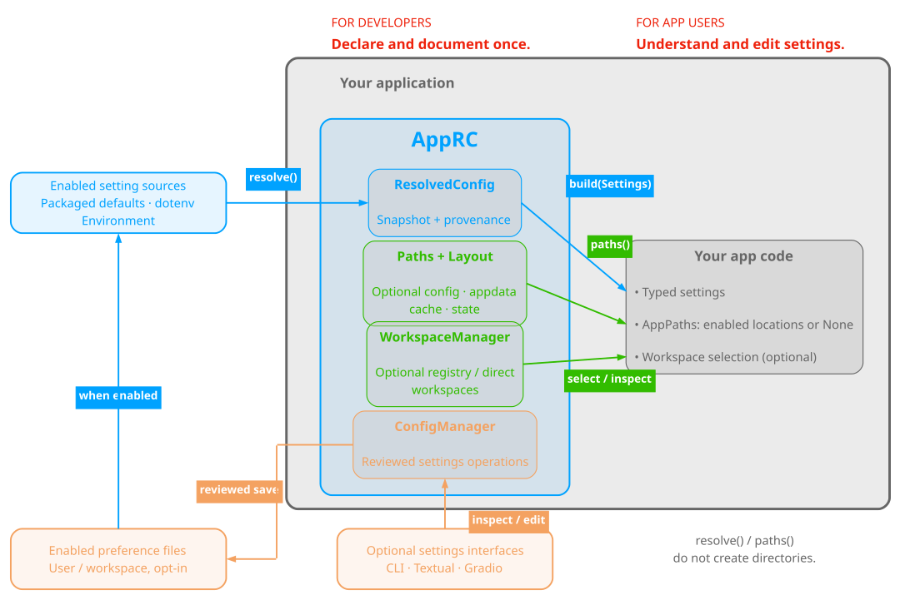
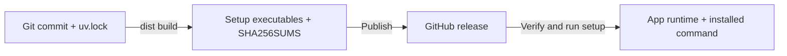
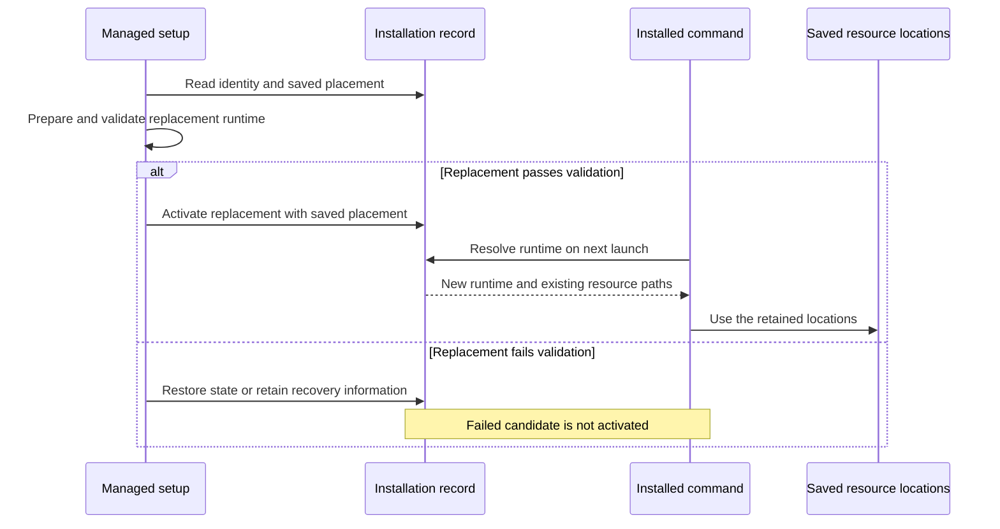
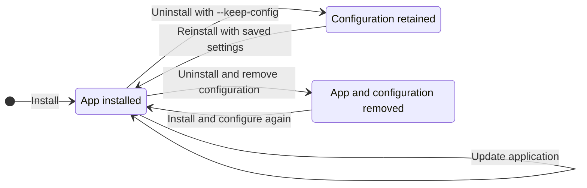

<!-- README EDITING CONTRACT
Adapt this README in place. Preserve its Buildben presentation, centered header,
badges, graphical abstract, heading hierarchy, spacing, and useful content.
Before editing, read "README maintenance" in docs/Development.md.
-->


<!-- ====================================================================== -->
<!-- --- URLs -->
[`typed-settings`]: https://typed-settings.readthedocs.io/en/stable/
[`python-dotenv`]: https://pypi.org/project/python-dotenv/
[`platformdirs`]: https://pypi.org/project/platformdirs/
[`filelock`]: https://pypi.org/project/filelock/
[Pydantic Settings]: https://docs.pydantic.dev/latest/concepts/pydantic_settings/
[uv]: https://docs.astral.sh/uv/
[PyApp]: https://ofek.dev/pyapp/latest/


<!-- ====================================================================== -->
<!-- == Header -->
<div align="center">


<!-- --- Title -->
<a id="project-overview"></a>
<a id="apprc-application-runtime-config"></a>

# `AppRC`


<!-- --- Badges -->

[](https://github.com/HisQu/apprc/actions/workflows/ci.yml)
[](LICENSE)
[](https://pypi.org/project/apprc/)
[](https://pypi.org/project/apprc/)

[](https://github.com/astral-sh/uv)
[](https://github.com/astral-sh/ruff)
[](https://microsoft.github.io/pyright/)
[](https://docs.pytest.org/)

</div>


<!-- --- Abstract -->

AppRC provides configuration, installation, and lifecycle management for Python
applications. Declare typed settings, opt into independent resources such as
config or cache, and add the interfaces your users need. When you ship a native
installer, AppRC can also register the command, keep the app's resource locations
across updates, and provide repair and uninstall.


<!-- --- Graphical Abstract -->

<br>

|  |
|:--:|
| **Fig. 1 - Graphical Abstract:** AppRC resolves typed settings from layered sources, applies optional workspace overrides, and shares one declaration across application code and configuration tools. |

<br>

---

<br>

<!-- ====================================================================== -->
### Table of Contents

1. [`AppRC`](#apprc)
   1. [Why AppRC?](#why-apprc)
2. [Installation](#installation)
   1. [Install the AppRC SDK](#install-the-apprc-sdk)
   2. [Install from a Cloned Repository](#install-from-a-cloned-repository)
   3. [Uninstall](#uninstall)
3. [Usage](#usage)
   1. [Load settings](#load-settings)
   2. [Choose application paths](#choose-application-paths)
   3. [Save user settings](#save-user-settings)
   4. [Add terminal commands](#add-terminal-commands)
   5. [Add a Gradio settings page](#add-a-gradio-settings-page)
   6. [Works with your existing application](#works-with-your-existing-application)
4. [Ship an application](#ship-an-application)
   1. [Build a release package](#build-a-release-package)
   2. [Verify installation, update, and removal](#verify-installation-update-and-removal)
   3. [Publish one-line install scripts](#publish-one-line-install-scripts)
5. [Use an installed application](#use-an-installed-application)
   1. [Choose an installation route](#choose-an-installation-route)
   2. [Run the application](#run-the-application)
   3. [Maintain the application](#maintain-the-application)
   4. [Try a preview beside the regular application](#try-a-preview-beside-the-regular-application)
   5. [Review removal and keep configuration](#review-removal-and-keep-configuration)
6. [Documentation](#documentation)

<br>

---


<!-- ====================================================================== -->
<br>


## Why AppRC?

*Turn your **prototypes** and **production code** into a cross-platform app!*

Even with **coding agents**, the surrounding
infrastructure needs to be designed, tested and maintained.
AppRC's CLI and extensive [*documentation*](docs/) give both
you and your agents a common foundation for application
**lifecycle** management across **all** your projects.

<br>

### For Your Users 👤

Don't lie to your users:

> **"Installation is easy..! You already have Python and Git, right?"**

**It should "just work":**
- ***Install*** Python applications like you're used to (`setup.exe`).
- ***Launch*** applications like you're used to (desktop shortcut).
- ***Configure*** settings through a UI instead of editing configuration files.
- ***Update*** applications without repeating the initial setup.
- ***Uninstall*** applications like you're used to: Start menu, desktop shortcut or `Add/Remove Programs`.

### For Researchers 🔬

> "You shouldn't need a coding agent to try 32 different workflows!"

Share your code as **installable applications**, without asking
your colleagues to use a terminal or set up software beforehand.
AppRC packages fixed software releases with locked dependencies,
helping make installations ***reproducible*** even years after publication.

### For Developers 💻

> The prototype took an afternoon. Getting it to run on someone else's machine took the rest of the week.

AppRC gives you a **single settings definition** that serves your Python
code, GUI, TUI and CLI. **Environment variables** make sharing
settings across languages and runtimes easy.

AppRC is **modular**. Its features are optional and designed to
complement tools like Pydantic, Typer, Gradio and uv. Its
environment-based configuration also works with TypeScript
applications running on Node.js, Bun or Deno, shell scripts and
Docker containers.


<!-- ====================================================================== -->
<br>

# Installation

<br>

<a id="one-line-install"></a>

## Install the AppRC SDK

**Choose what your application needs.** These commands are for application
developers. If you received an application, follow its
[installation instructions](#use-an-installed-application).

The SDK requires Python 3.12 or newer.

| You need | Install | Includes |
| --- | --- | --- |
| Configuration and management APIs | `python -m pip install apprc-core` | Typed settings and noninteractive path and maintenance APIs. |
| Terminal commands and settings editing | `python -m pip install apprc` | The core, Typer integration, prompts, and the Textual editor. |
| An embedded browser settings editor | `python -m pip install apprc-gui` | The core and the Gradio editor. |

Choose paths, saved preferences, workspaces, and managed distribution separately.
A settings-only application needs no managed files; a cache-only application
needs no configuration directory. The [capability model](docs/Explanations.md#optional-capabilities)
and [example selector](docs/EXAMPLES.md#choose-a-setup) show the combinations.

Both `apprc-core` and `apprc` use `import apprc`. The GUI provides
`from apprc_gui import ConfigEditor`. Terminal and GUI distributions depend on
the matching core release and can be used together.

These commands install published SDK releases. This README and the linked
source guides describe `main`; an application's installer includes the
features supplied by the release that built it. See
[release and upgrade guidance](#release-context-and-upgrades).

<br>

## Install from a Cloned Repository

Follow the [development environment](docs/Development.md#environment) instructions
for editable installs of the core and optional terminal/GUI distributions.
Ordinary pip installations do not require uv.

<br>

## Uninstall

To remove the SDK packages from the Python environment where you installed them:

```shell
python -m pip uninstall apprc apprc-gui apprc-core
```

Remove only the distributions you no longer need. Keep `apprc-core` when another
installed application depends on it. SDK package removal leaves application
resources in place; an application's
[uninstall workflow](#review-removal-and-keep-configuration) handles its program
and managed resources.


<!-- ====================================================================== -->
<br>

# Usage

<br>

## Load settings

**Give a setting one definition that application code and configuration tools
can share.**

Create an [`AppRC`](docs/Explanations.md#apprc), register a
[config section](docs/Explanations.md#config-sections-and-fields), and resolve
typed values. This complete example prints `10`:

```python
import apprc as rc

MyRC = rc.AppRC(app_id="yourapp")

@MyRC.config("client", prefix="YOURAPP_")
class ClientSettings(rc.Config):
    timeout: int = rc.field(
        "YOURAPP_TIMEOUT",
        default=30,
        description="Seconds to wait for a response.",
    )

resolved = MyRC.resolve(environment={"YOURAPP_TIMEOUT": "10"})
settings = resolved.build(ClientSettings)
print(settings.timeout)
```

`resolve()` captures the configuration sources; `build()` converts values and
validates required fields. Resolution leaves files and `os.environ` unchanged.
[Provenance](docs/Explanations.md#provenance) records where a value came from,
so a surprising setting has an explanation.

Add [dotenv files](docs/How-To-User-Guides.md#load-dotenv-files) or
[packaged defaults](docs/How-To-User-Guides.md#ship-defaults-with-the-application)
as needed. Related sections can share a
[config bundle](docs/How-To-User-Guides.md#pass-several-settings-sections-together),
and [temporary overrides](docs/How-To-User-Guides.md#reload-settings-or-use-temporary-overrides)
let one operation use different values without rewriting saved preferences.

<br>

## Choose application paths

**Know where the application's files belong.** Enable `config`, `appdata`,
`cache`, and `state` independently. This complete example declares only a cache:

```python
import apprc as rc

MyRC = rc.AppRC(
    app_id="yourapp",
    paths=rc.Paths(cache=True),
    layout=rc.Layout.native(),
)

paths = MyRC.paths()                   # inspect without creating directories
cache_dir = MyRC.ensure_path("cache")  # initialize and record ownership
```

[`Layout.native()`](docs/How-To-User-Guides.md#choose-and-initialize-application-paths)
uses platform user locations; `Layout.single_root(root)` groups enabled
resource directories. Managed [installation](docs/Explanations.md#installation)
retains the selected placement. Runtime and installation-support locations
remain separate. Optional [workspaces](docs/Explanations.md#workspaces) select
working directories and configuration overrides without relocating application
resources.

<br>

## Save user settings

**Let users keep their choices between runs.** Declare
`paths=rc.Paths(config=True)` and `user_dotenv=rc.UserDotenv()` to save user
overrides in `apprc.user.env`. Obtain a
[`ConfigManager`](docs/Explanations.md#configmanager) with `MyRC.manage()` for
inspection, setup, and reviewed edits.

AppRC preserves unrelated dotenv entries and comments when editing settings.
Its editors use the declared types, choices, help, and editability metadata.
Fields marked `restart_required=True` tell users when a saved change needs a
restart. Declared secrets are masked in AppRC displays and saved in private
[secret companion files](docs/Explanations.md#secret-companions).

Follow the [saved-preference guide](docs/How-To-User-Guides.md#save-a-user-preference)
for a complete example, or use [workspace settings](docs/How-To-User-Guides.md#select-a-workspace)
when different projects need different overrides.

<br>

## Add terminal commands

Mount configuration and maintenance commands alongside the application's Typer
commands. This integration excerpt assumes your application exposes `MyRC`:

```python
import apprc as rc
import typer
from my_app.config import MyRC

app = typer.Typer(cls=rc.cli.AppRCRootGroup)
rc.cli.mount_app_cli(app, MyRC)
```

The [complete Typer example](docs/How-To-User-Guides.md#add-configuration-commands-to-typer)
shows settings edits and inspection. `app paths` and `app doctor` are available;
other commands follow declared capabilities. Opting into installation management
adds editable registration and maintenance; managed installation uses native
setup or an explicit installer delegate. Resource operations require
[application maintenance handlers](docs/How-To-User-Guides.md#supply-application-maintenance-operations).

The [command reference](docs/References.md#terminal-commands) covers help,
grouping, and runtime options. An optional
[Textual launcher](docs/How-To-User-Guides.md#launch-the-optional-textual-application-screen)
provides a management screen.

<br>

## Add a Gradio settings page

**Reuse the same settings declaration in the application's browser interface.**
Embed the editor in your existing Gradio `Blocks`. This excerpt uses a
configuration-enabled `MyRC` from your application:

```python
import gradio as gr
from apprc_gui import ConfigEditor
from my_app.config import MyRC

with gr.Blocks() as page:
    with gr.Tab("Settings"):
        ConfigEditor(MyRC.manage()).render()
```

The application owns the page, server, and launch behavior. For registry-backed
workspaces, pass `workspace_manager=MyRC.workspaces()` to `ConfigEditor`.
Each browser session edits the workspace shown in its settings view.
The [Gradio guide](docs/How-To-User-Guides.md#add-a-gradio-settings-page)
covers the complete integration and initialization behavior.

<br>

## Works with your existing application

| Existing tool or component | How AppRC fits |
| --- | --- |
| **Pydantic models** | Pass resolved settings into existing application or API models through explicit construction or attribute-based validation. |
| **Typer** | [Mount AppRC commands](#add-terminal-commands) alongside application commands. |
| **Textual and Gradio** | Use the [terminal editor](docs/How-To-User-Guides.md#inspect-and-edit-settings-in-the-terminal) or [embed Gradio controls](#add-a-gradio-settings-page) driven by the same fields. |
| **Dependencies using AppRC** | [Map dependency settings](docs/How-To-User-Guides.md#import-settings-from-a-dependency) into fields owned by the parent application. |
| **Other runtimes and environment-based libraries** | Share dotenv configuration or [explicitly export file-contributed values](docs/How-To-User-Guides.md#supply-settings-to-environment-only-code) into the process environment for those components. |

For a project that already uses Pydantic, the following continues the
[settings example](#load-settings). Matching attributes become validated model
values through [Pydantic's public API](https://docs.pydantic.dev/latest/concepts/models/#arbitrary-class-instances):

```python
from pydantic import BaseModel

class ClientOptions(BaseModel):
    timeout: int

options = ClientOptions.model_validate(settings, from_attributes=True)
assert options.timeout == 10
```

This is an explicit value handoff. AppRC's registered settings classes remain
`rc.Config` or `rc.ConfigBase`; the existing Pydantic model keeps its own schema.


<!-- ====================================================================== -->
<br>

# Ship an application

<br>

## Build a release package

The distribution workflow packages a committed project snapshot and `uv.lock`
into a native setup executable. After verifying that executable, the recipient
runs it to prepare the locked runtime and publish the application command.
Windows setup executables carry the application version in their file metadata,
which the managed command inherits.



To add distribution to an existing application:

1. Declare the runtime and command metadata in `pyproject.toml` using the
   [native application declarations](docs/Development.md#native-application-frontends).
2. Compose the public [snapshot and native distribution builders](docs/References.md#distribution-generation)
   in your application's authored build module, and register its authoring backend.
3. Prepare the [native setup toolchain](docs/Development.md#native-setup-toolchain)
   and commit the source and lockfile you want to distribute.
4. Build and check the setup for the chosen targets.

For a configured application whose command is `yourapp`, run these from its checkout:

```shell
uv run --locked yourapp dist build -t
uv run --locked yourapp dist check -t
```

`-t` selects the current platform. Final setup executables and `SHA256SUMS`
appear in ignored `dist/`; build intermediates stay in `.cache/apprc/`.
Follow the [release package guide](docs/How-To-User-Guides.md#prepare-a-release-package)
for target requirements and artifact verification. Compiler failures include
Cargo diagnostics in the reported error.

For applications with a static web frontend, prepare the assets during authoring
and include them in the project snapshot. Recipients then use those built
assets without installing the frontend build tools. Dependency acquisition
follows uv and may require network access or private repository credentials.

<br>

## Verify installation, update, and removal

**Check the experience your users will actually receive.** In a checkout with
distribution authoring and installation management enabled, `dist test` guides
you through the selected lifecycle:

| Command | What it exercises |
| --- | --- |
| `yourapp dist test` | Register an editable installation, check it, and uninstall it. |
| `yourapp dist test --managed` | Install a built release, check it, and uninstall it. |
| `yourapp dist test --update-from OLD_SETUP` | Install the supplied older setup, update to the current checked setup, verify, and uninstall. |

Stop the application and any background servers before testing. Run these
through `uv run --locked` in the application checkout. The workflow
performs real installation and removal and writes its report under
`.cache/apprc/dist-test/`. Automated checks and manual observations are recorded
separately. The [validation guide](docs/How-To-User-Guides.md#validate-installation-on-your-machine)
explains the prompts, update checks, and reports.

<br>

## Publish one-line install scripts

Publish the setup executables and `SHA256SUMS` as application release assets.
You can also generate **One-line install scripts (OLIS)** for Bash and PowerShell
and host them at a trusted URL. For a public GitHub release:

**Bash**

```bash
RELEASE_PUBLIC=true uv run --locked yourapp dist build --olis-repo OWNER/REPO
```

**PowerShell**

```powershell
$env:RELEASE_PUBLIC = "true"
uv run --locked yourapp dist build --olis-repo OWNER/REPO
```

Private releases use `RELEASE_PUBLIC=false` and require authenticated GitHub
access. Supply the application's release repository with `--olis-repo` or
`RELEASE_REPO_OLIS`. The published script selects, downloads, verifies, and
launches setup from the latest stable release by default. Authenticated scripts
also accept channel flags for beta and release-candidate installs. For an analysis
tied to a specific release, share that release's identified setup. See the
[script generation guide](docs/How-To-User-Guides.md#generate-one-line-install-scripts).


<!-- ====================================================================== -->
<br>

# Use an installed application

<br>

## Choose an installation route

The application publisher supplies the download, command name, and setup
instructions. Choose the route matching what you received:

| What you have | Route | Result |
| --- | --- | --- |
| A published install command | [One-line installer (OLI)](docs/How-To-User-Guides.md#run-a-published-installer) | Download, verify, and run the released setup. |
| A downloaded setup executable | [Released Binary Executable (RBE)](docs/How-To-User-Guides.md#run-a-published-installer) | Install the release directly. |
| A development checkout to keep editing | [Editable Source Checkout (eSC)](docs/How-To-User-Guides.md#install-from-a-checkout) | Register the checkout's command and reuse its existing environment. |
| A checkout from which to install a release | [Source Build (SB)](docs/How-To-User-Guides.md#install-from-a-source-build) | Build or reuse the setup, then install a release. |

Native setup shows the [installed and incoming versions](docs/How-To-User-Guides.md#update-an-application)
before reporting its resolved paths, result, and application-supplied next step.
On Windows, a double-clicked setup keeps its result visible until you press Enter.

<br>

## Run the application

Use the installed command or an installed shortcut. The application chooses
what a bare command does, such as opening a browser interface or starting a
local server.

Setup can create a desktop shortcut; editable registration also accepts
`yourapp app install -e --desktop`. If setup changed user PATH, open a new terminal
before using the command. The [launch guide](docs/How-To-User-Guides.md#run-the-installed-application)
covers command publication, shortcuts, and Windows application registration.

<br>

## Maintain the application

### Update the application

From an installation that supports updates, stop the application and run:

```shell
yourapp app update
```

The shorter `yourapp update` alias is enabled by default. A host with its own
root `update` command can set `AppRC(update_alias=False)` and keep the nested
`yourapp app update` command.

Managed updates use the latest stable release from the publisher's configured
source by default. Use `yourapp app update --version VERSION` or `-v` to choose
a published release, including a prerelease. Enter the GitHub release tag, the
app version, or the numeric version shown by Windows. The
[update guide](docs/How-To-User-Guides.md#update-an-application)
explains release selection, version checks, and editable checkout updates.
Applications can declare an [asset preparation command](docs/References.md#application-update)
that runs before editable dependency sync and registration. Update support
depends on the version the application ships.

For a managed app with a preview identity, use
`yourapp app install --preview --version VERSION` to install a published release
as a preview. Use `yourapp update --preview --version VERSION` to update an
existing preview when the alias is enabled. A publisher can make standalone
beta and release-candidate setups default to Preview.
If the Preview command ends in `-preview`, its setup can also publish a short
`-p` alias. For example, `yourapp-p` runs `yourapp-preview` when the alias is available.

### Keep the installation's saved placement

Managed setup prepares and validates a replacement runtime before activating it.
Successful activation keeps the saved resource locations. A failed candidate
is not activated; AppRC restores its changes or reports the recovery state.
Application-specific data migrations and external service effects remain the
application's responsibility.



The [installation explanation](docs/Explanations.md#activation-repair-and-rollback)
describes activation, recovery, and retained runtimes.

### Inspect before choosing a recovery action

Use `yourapp app paths --json` to inspect placement and `yourapp app doctor --json`
for structured diagnostics. Doctor identifies any pending operation and gives its
retry step. The [installation recovery guide](docs/How-To-User-Guides.md#inspect-or-repair-installation)
explains how to resume a checkout registration or recover a managed runtime.

<br>

## Try a preview beside the regular application

An opted-in preview has its own application identity, command, registration,
and managed resources. It can run alongside the regular installation.

| Command | Result |
| --- | --- |
| `<setup> --preview` | Install or update the preview and leave it installed. |
| `<setup> --smoke` | Install a fresh preview, verify its runtime, and wait for uninstall to finish. |
| `<preview-command> app uninstall` | Remove the preview through its ordinary uninstall workflow. |

An opted-in checkout also offers these options in `yourapp app install --help`
for a [Source Build](docs/How-To-User-Guides.md#install-from-a-source-build).
For applications that run servers, give regular and preview instances different
configurable TCP ports or socket paths. The application also owns its external
service and shared database settings.

Follow the [preview guide](docs/How-To-User-Guides.md#install-a-preview-or-run-a-smoke-test)
for shell-specific commands and smoke requirements. Authors should also follow
the [preview identity and endpoint policy](docs/Development.md#verify-an-opted-in-preview-identity).

<br>

## Review removal and keep configuration

Stop the application, including running servers. Interactive uninstall warns
when AppRC detects a busy managed runtime. For an installed application named
`yourapp`, start with a preview:

```shell
yourapp app uninstall --keep-config --dry-run
yourapp app uninstall --keep-config
```

The dry run shows **Delete** and **Keep** targets. `--keep-config` retains
configuration, including saved settings and secrets, for a later reinstall.
An update keeps configuration in place. An uninstall that removes configuration
leaves the next install to configure the application again.



Interactive uninstall offers to keep existing configuration. Unattended
`--yes` removes configuration unless `--keep-config` is also supplied.
Appdata, cache, and state remain removal targets. Back up needed application
data outside the listed targets before confirming removal. Editable uninstall
preserves the checkout and development environment by default.

The [removal guide](docs/How-To-User-Guides.md#remove-a-managed-program)
defines the retention choices, ownership checks, and explicit repository removal.


<!-- ====================================================================== -->
<br>

# Documentation

### Using the project

- [Documentation](docs/README.md): Choose a reader journey and find the right page.
- [How-to user guides](docs/How-To-User-Guides.md): Complete tasks with independent examples.
- [Examples](docs/EXAMPLES.md): Choose and run complete application setups.
- [Explanations](docs/Explanations.md): Understand components and their relationships.
- [References](docs/References.md): Look up APIs, files, commands, and exact behavior.

### Contributing and maintaining

- [Development](docs/Development.md): Change, verify, build, and release AppRC.
- [Documentation checks](docs/Development.md#documentation-checks) and [README maintenance](docs/Development.md#readme-maintenance): Preserve the documentation contracts and Buildben presentation.
- [Changelog](CHANGELOG.md): Release history and migration requirements.

<a id="main-dependencies"></a>

### Built on

- **[`typed-settings`]**: Typed conversion and validation.
- **[`python-dotenv`]**: Dotenv input.
- **[`platformdirs`]**: Native per-user application paths.
- **[`filelock`]**: Serialized persistent configuration and resource operations.
- **[uv] and [PyApp]**: Dependency installation and native runtime bootstrapping.

### Release context and upgrades

Existing integrations should follow the
[migration guide](docs/How-To-User-Guides.md#migrate-existing-applications),
including the 0.32 API and on-disk configuration changes. AppRC does not
automatically move or convert old user files; preserve them and configure
the new paths deliberately.

Ordinary CI runs core checks on Ubuntu with Python 3.12. Extended release CI
adds core checks on Python 3.13 and 3.14 and GUI/browser checks on Python 3.14.
See the [CI profiles](docs/Development.md#environment). Native platform
follow-ups are tracked in the
[platform status](BACKLOG.md#p3--e1-tooling---windows-and-macos-installation-validation-is-deferred)
and [shortcut validation](BACKLOG.md#p3--e3-bug-risk---verify-managed-desktop-shortcuts-on-windows)
entries.
