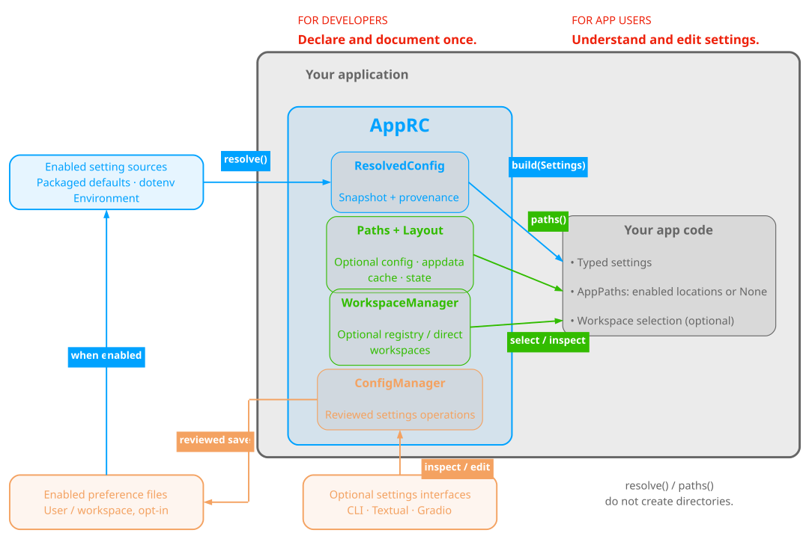

<!-- README EDITING CONTRACT
Adapt this README in place. Preserve its structure, HTML layout, heading levels,
spacing, and useful content. Replace placeholders and update facts within this
design. Before editing, read "README maintenance" in docs/Development.md.
-->


<!-- ====================================================================== -->
<!-- --- URLs  -->
[`typed-settings`]: https://pypi.org/project/typed-settings/
[`python-dotenv`]: https://pypi.org/project/python-dotenv/
[`platformdirs`]: https://pypi.org/project/platformdirs/
[`filelock`]: https://pypi.org/project/filelock/


<!-- ====================================================================== -->
<!-- == Header -->
<div align="center">


<!-- --- Title  -->
<a id="project-overview"></a>

# `AppRC`: Application Runtime Config


<!-- --- Badges -->

[](https://github.com/HisQu/apprc/actions/workflows/ci.yml)
[](LICENSE)
[](https://pypi.org/project/apprc/)
[](https://pypi.org/project/apprc/)


[](https://github.com/astral-sh/uv)
[](https://github.com/astral-sh/ruff)
[](https://microsoft.github.io/pyright/)
[](https://docs.pytest.org/)


</div>


<!-- --- Abstract  -->

AppRC provides typed application settings, optional user preferences, and
independent application paths. An application opts in to configuration,
application data, cache, and state separately; a cache-only application does not
also acquire configuration files or a workspace registry.


#### Main dependencies:
- **[`typed-settings`]**: Convert and validate typed application settings.
- **[`python-dotenv`]**: Read setting values from dotenv files.
- **[`platformdirs`]**: Resolve native per-user application paths.
- **[`filelock`]**: Serialize persistent configuration and resource operations.


<!-- --- Graphical Abstract  -->

<br>

|  |
|:--:|
| **Fig. 1 - Graphical Abstract:** AppRC resolves typed settings from layered sources, applies optional workspace overrides, and shares one declaration across application code and configuration tools. |

<br>

---


<!-- ====================================================================== -->
### Table of Contents

1. [`AppRC`: Application Runtime Config](#project-overview)
2. [Installation](#installation)
   1. [One-Line Install](#one-line-install)
   2. [Install from a Cloned Repository](#install-from-a-cloned-repository)
   3. [Uninstall](#uninstall)
3. [Usage](#usage)
   1. [Load settings](#load-settings)
   2. [Choose application paths](#choose-application-paths)
   3. [Save user settings](#save-user-settings)
   4. [Add terminal commands](#add-terminal-commands)
   5. [Add a Gradio settings page](#add-a-gradio-settings-page)
4. [Documentation](#documentation)

---

<!-- ====================================================================== -->
<br>

# Installation

<br>

## One-Line Install

Python 3.12 or newer is required.

| Command | Includes |
| --- | --- |
| `python -m pip install "apprc>=0.34.0,<0.35"` | Core configuration, Typer commands, prompts, and Textual editor. |
| `python -m pip install "apprc-core>=0.34.0,<0.35"` | Configuration and noninteractive path/maintenance APIs. |
| `python -m pip install "apprc-gui>=0.34.0,<0.35"` | Configuration and Gradio settings editor. |

`apprc-core` and `apprc` use `import apprc`; `apprc-gui` provides
`from apprc_gui import ConfigEditor`. Terminal and GUI distributions install the
matching `apprc-core` release.

> [!CAUTION]
> Version 0.32 makes a breaking API and on-disk configuration cutover. Existing
> `Storage`, `storage`, `apprc_dir`, and `--storage` integrations must be changed
> to the new contracts described in the
> [upgrade guide](docs/How-To-User-Guides.md#migrate-existing-applications).
> AppRC does not move, rename, scan, delete, or automatically upgrade old user
> files. Keep any old files as-is and deliberately configure the new paths.

CI runs on Ubuntu: core checks cover Python 3.12, 3.13, and 3.14, and GUI/browser
checks cover Python 3.12. Windows and macOS runtime and installer code remain,
but those platforms are unverified by this CI policy and have
[known native test failures](BACKLOG.md#p2--e1-tooling---windows-and-macos-installation-ci-fails).

<br>

## Install from a Cloned Repository

Follow the [development environment](docs/Development.md#environment) instructions
for editable installs of the core and optional terminal/GUI distributions.
Ordinary pip installations do not require uv.

<br>

## Uninstall

Use the same Python environment as for installation. To remove all three
AppRC distributions:

```shell
python -m pip uninstall apprc apprc-gui apprc-core
```

Remove only the distributions you no longer need. Keep `apprc-core` if another
installed application or library depends on it. Package removal does not purge
application configuration, data, cache, state, or workspaces; application-owned
resource maintenance is a separate, explicit operation.


<!-- ====================================================================== -->
<br>

# Usage

<br>

## Load settings

Create one [`AppRC`](docs/Explanations.md#apprc), register
[config sections](docs/Explanations.md#config-sections-and-fields), then build
typed settings from a `ResolvedConfig`:

```python
import apprc as rc

MyRC = rc.AppRC(app_id="demo")

@MyRC.config("client", prefix="DEMO_")
class ClientSettings(rc.Config):
    timeout: int = rc.field("DEMO_TIMEOUT", default=30)

resolved = MyRC.resolve(environment={"DEMO_TIMEOUT": "10"})
settings = resolved.build(ClientSettings)
assert settings.timeout == 10
```

`resolve()` reads configuration and captures a snapshot; `build()` converts
values and validates required fields. Add [dotenv files](docs/How-To-User-Guides.md#load-dotenv-files)
or [packaged defaults](docs/How-To-User-Guides.md#ship-defaults-with-the-application)
when required. [Provenance](docs/Explanations.md#provenance) records which source
supplied each value. Resolution does not write files or alter `os.environ`.

<br>

## Choose application paths

Declare only the managed components the application uses:

```python
import apprc as rc

MyRC = rc.AppRC(
    app_id="demo",
    paths=rc.Paths(cache=True),
    layout=rc.Layout.native(),
)

paths = MyRC.paths()                   # inspect; no filesystem writes
cache_dir = MyRC.ensure_path("cache")  # create privately and record ownership
```

`Paths` independently enables `config`, `appdata`, `cache`, and `state`.
`Layout.native()` uses platform user locations; `Layout.single_root(root)` places
enabled categories beneath one explicit root. `AppPaths` reports disabled
locations as `None`; `ensure_path(kind)` initializes only the requested
component. See [path declarations](docs/Explanations.md#application-paths) and
the [path reference](docs/References.md#application-paths).

Managed installers preserve the selected layout in a durable
[installation record](docs/Explanations.md#installation). Reinstallation reuses
that choice; an invocation override does not rewrite it. Single-root groups the
enabled application resource directories, not the Python environment or fixed
native installation support. Plain `pip install -e .` remains independent of
this optional installation workflow.

Applications that need selectable named working directories declare
`Workspaces()`. A [`WorkspaceManager`](docs/Explanations.md#workspaces) manages
the registry and archive operations separately from `AppPaths`; selecting a
workspace does not relocate configuration, cache, or state. `registry=False`
permits direct-directory selection without enabling config. Call
`WorkspaceManager.initialize_workspace(root)` or use `workspace init PATH` to
prepare the workspace dotenv; this writes no config or registry file.

<br>

## Save user settings

`user_dotenv=rc.UserDotenv()` opts into `apprc.user.env` inside the enabled config
directory. `UserDotenv` requires `paths=rc.Paths(config=True)`; it never enables
config implicitly. Obtain a [`ConfigManager`](docs/Explanations.md#configmanager)
with `MyRC.manage()` for settings inspection, setup, and reviewed edits. The
[saved-preference guide](docs/How-To-User-Guides.md#save-a-user-preference)
contains a complete example. Saved secrets use private companion files; the
[secret explanation](docs/Explanations.md#secret-companions) describes their limits.

<br>

## Add terminal commands

Use `rc.cli.mount_app_cli(app, MyRC)` to add configuration and application
maintenance alongside the host's commands. `config` and `workspace` appear when
their capabilities exist; `app paths` and `app doctor` are always available.
`config setup [--adopt] [--yes/-y]` initializes only enabled user configuration.
The maintenance group defaults to `app` and can be renamed with
`maintenance_group_name`. The returned mapping identifies actual mounted paths,
such as `app.cache`, for application extensions. See the
[Typer guide](docs/How-To-User-Guides.md#add-configuration-commands-to-typer)
and [command reference](docs/References.md#terminal-commands).

Resource commands are nested under `app`: `app data backup/restore`,
`app cache prune/clear`, and `app state prune/reset` appear only for supported
operations. Declaring a path alone does not enable these commands or create its
directory. `app repair`, `app uninstall`, and `app migrate` require
`installation_management=True`; `app install` additionally requires an explicit
`installer_entrypoint` callable. There are no resource `init` or `purge` CLI
aliases. Python `ensure_path` and maintenance purge planning remain available
with their existing [ownership and safety boundaries](docs/Explanations.md#maintenance).

Passing `launcher_spec` and `launcher_handlers` adds optional root `launch`,
which opens the existing Textual management launcher. It is separate from a
foreground application command and from saved distribution launch support.
Hosts can opt into separated root help panels with
`typer.Typer(cls=rc.cli.AppRCRootGroup)`; nested help stays standard.

The [Textual editor](docs/Explanations.md#config-editor) and
[Gradio editor](docs/Explanations.md#gradio-editor) edit config settings; when a
workspace registry exists, callers supply the separate `WorkspaceManager`.
Editors do not initialize application state merely by opening.

<br>

## Add a Gradio settings page

Embed `apprc_gui.ConfigEditor(manager)` in an application-owned Gradio `Blocks`.
If the application declares registry-backed workspaces, provide
`workspaces=MyRC.workspaces()` as well. The
[Gradio guide](docs/How-To-User-Guides.md#add-a-gradio-settings-page) shows the
integration.

AppRC's optional
[`apprc.distribution`](docs/References.md#distribution-generation) authoring APIs
generate Rust-free Python developer entries and standalone lifecycle support.
In a generated application checkout, use `uv run --script app-install.py` and
`uv run --script app-launch.py`; installation preserves the actual editable
checkout, including dirty source. Native release executables are a separate,
explicit [authoring build](docs/Development.md#native-application-frontends),
not a prerequisite for normal generation. Recipients use uv for the application
environment; PyApp manages only the native frontend's Python bootstrap.
Applications still own lifecycle actions and Windows `Setup.exe` builds.

<!-- ====================================================================== -->
<br>

# Documentation

### Using the project
- [Documentation](docs/README.md) — Start here for component names and learning order.
- [How-to user guides](docs/How-To-User-Guides.md) — Complete specific tasks with independent examples.
- [Examples](docs/EXAMPLES.md) — Choose and run complete application setups, including cache-only.
- [Explanations](docs/Explanations.md) — Understand components and how they connect.
- [References](docs/References.md) — Look up exact APIs, files, commands, and behavior.

### Contributing and maintaining
- [Development](docs/Development.md) — Change, verify, build, and release AppRC.
  - [Development environment](docs/Development.md#environment)
  - [Source ownership](docs/Development.md#source-ownership)
  - [Documentation checks](docs/Development.md#documentation-checks)
  - [README maintenance](docs/Development.md#readme-maintenance)
  - [Verification](docs/Development.md#checks)
  - [Releases](docs/Development.md#release-procedure)
- [Changelog](CHANGELOG.md) — Current release notes and migration requirements; [older releases](CHANGELOG-ARCHIVE.md) are archived.
