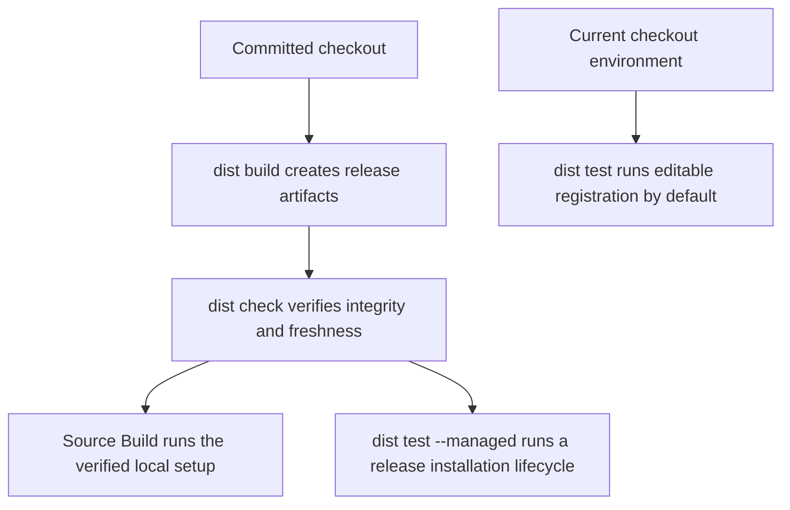

# Development

[Contributing](../CONTRIBUTING.md) · [Documentation](README.md) · [Explanations](Explanations.md) · [How-to user guides](How-To-User-Guides.md) · [References](References.md) · [Examples](EXAMPLES.md)

Use [CONTRIBUTING.md](../CONTRIBUTING.md) for shared repository rules and its quick start. This guide covers detailed technical procedures.

- [Work in the repository](#work-in-the-repository)
  - [Environment](#environment)
  - [Source ownership](#source-ownership)
  - [Lightweight CLI startup](#lightweight-cli-startup)
- [Verify and update changes](#verify-and-update-changes)
  - [Checks](#checks)
  - [Documentation checks](#documentation-checks)
  - [Actions artifact diagnostic](#actions-artifact-diagnostic)
  - [README maintenance](#readme-maintenance)
  - [Generated files](#generated-files)
- [Build and release AppRC](#build-and-release-apprc)
  - [Build the three distributions](#build-the-three-distributions)
  - [Native application frontends](#native-application-frontends)
  - [Native setup toolchain](#native-setup-toolchain)
  - [Verify an application distribution](#verify-an-application-distribution)
  - [Release procedure](#release-procedure)

<br>

# Work in the repository

## Environment

Ordinary pushes and pull requests run core checks on Ubuntu with Python 3.12.
Release-candidate tags run the extended core matrix on Python 3.12, 3.13, and
3.14, plus GUI/browser checks on Python 3.14. Stable tags run the same matrix
unless the workflow finds successful CI from a matching release candidate.
In that case, the stable tag runs only the core Python 3.12 checks. Beta tags
run core Python 3.12 checks when hosted CI is required and skip them otherwise.
Windows and macOS runtime and installer code remain outside this CI policy. Existing
[native installation and UI test failures](../BACKLOG.md#p2--e1-tooling---windows-and-macos-installation-ci-fails)
remain unresolved; a green Linux run does not establish native compatibility.
`uv`, `direnv`, and `just` are conveniences. Runtime, builds, and pip development
installs do not require their commands.

Ordinary pip setup from the repository root:

```shell
python -m venv .venv
.venv/bin/python -m pip install --upgrade pip
.venv/bin/python -m pip install -e . -e src/apprc_dev/packaging/terminal -e src/apprc_dev/packaging/gui -e examples/example_apps --group dev
```

On Windows use `.venv\Scripts\python.exe`. The `dev` dependency group includes
tests, Ruff, Pyright, build/metadata tools, diagrams, and examples. If developing
only the core, `python -m pip install -e .` is sufficient for its dependencies.
Install local examples with `python -m pip install -e examples/example_apps`
after installing the local terminal wrapper.

For the locked development environment:

```shell
uv sync --locked --all-packages --all-groups
```

The root uv workspace includes the terminal and GUI projects. `--all-packages`
selects every workspace project, including the GUI; source mappings alone do not
select projects for installation. `--all-groups` also installs the development
tools and editable examples. Do not change shell startup files or `PATH` to
locate project tools; use `.venv/bin/<tool>`.

## Source ownership

| Path | Purpose |
| --- | --- |
| `src/apprc/definition` | Validated metadata, path declarations, and shared records |
| `src/apprc/runtime` | Explicit resolution, path snapshots, and config lifecycle |
| `src/apprc/services` | Config, workspace, maintenance and installation orchestration |
| `src/apprc/user_files` | File parsing, ownership, persistence, workspace operations |
| `src/apprc/interfaces` | Typer and Textual adapters |
| `src/apprc/public` | Application declaration facade |
| `src/apprc/scaffold` | Small generated application layout |
| `src/apprc/distribution` | Project metadata, verified source snapshots and explicit native setup authoring |
| `src/apprc/distribution/runtime` | Locked slots, editable registration, independent management and ownership-aware recovery/removal |
| `src/apprc/user_files/installation` | Strict installation authority I/O, revision checks, locks and migration |
| `src/apprc/interfaces/tui/launcher` | Optional single-event-loop management and foreground-command interface |
| `src/apprc_dev/packaging` | Metadata generation, install checks, release helpers |
| `src/apprc_dev/packaging/gui/src/apprc_gui` | Gradio presentation; no copy of the core's `apprc` modules |
| `tests` | Behavior, architecture, and integration checks |
| `examples/example_apps` | Curated CLIs, automated runner, manual lab |
| `docs/assets` | Diagram source scripts and generated SVGs; generated diagrams must follow their source scripts |

The root project builds `apprc-core` and owns all `apprc` Python files. The
`src/apprc_dev/packaging/terminal` project builds `apprc`, owns no Python package,
and supplies dependencies plus the console entrypoint. Never add a second copy
of an `apprc` module to that wrapper.
`src/apprc_dev/packaging/gui` builds `apprc-gui`, which owns only `apprc_gui`.
Its `ConfigEditor` calls `ConfigManager`; it does not implement file writes.

Production `__init__.py` files contain imports and module docstrings only.
Architecture tests enforce declaration dependency direction. The installation
schema belongs in `definition/installation.py`; filesystem authority and
coordination belong in `user_files/installation`; application-bound orchestration
belongs in `services/installation.py`. Do not put business configuration or
generator dependencies into those lower layers.

Current installation recovery resumes only operations represented by schema-3
authority. Resource/layout migration still moves explicitly enumerated,
revision-checked files and preserves unknown content; it is not receipt adoption.
Validate the inventory before publishing pending authority and again when
resuming it: decoded path types alone do not establish containment. Schema-1 and
schema-2 installation records require the explicit
[reinstallation procedure](How-To-User-Guides.md#from-installation-record-schema-1-or-2),
not a version-number edit or automatic conversion.

Start in [`_managed.py`](../src/apprc/distribution/runtime/installation/_managed.py)
for setup, replacement, and managed repair, or in
[`_editable.py`](../src/apprc/distribution/runtime/installation/_editable.py)
for checkout registration. Each route selects its candidate and command outputs
under the installation lock. Managed candidate preparation materializes and
verifies the project snapshot, synchronizes and probes the runtime, and invokes
resource initialization. Editable registration probes an existing environment.
[Candidate preparation](../src/apprc/distribution/runtime/installation/_candidate.py)

Both routes use the same checkpoints, activation commit, Windows registration,
and caught-failure recovery. Resource handling validates ownership and records
whether each root and owner marker existed before initialization, so rollback
can identify artifacts created by the attempt.
[Transaction](../src/apprc/distribution/runtime/installation/_transaction.py) ·
[Resource handling](../src/apprc/distribution/runtime/installation/_resources.py)

Command placement selects destinations and can add a verified, committed
command directory to the Windows user PATH. Command publication owns the writes,
recorded before-images, resume, and command rollback. The native manager and
editable CLI call optional configuration setup and shortcut creation after
activation.
[Placement](../src/apprc/distribution/runtime/installation/_commands.py) ·
[Publication](../src/apprc/distribution/runtime/_command_publication.py) ·
[Optional setup](../src/apprc/distribution/runtime/installation/_post_install.py)

Use `plan_resume()` for an exact pending operation and `plan_repair()` only for
a new managed repair. A candidate rebuilt during the current invocation is not
rebuilt again after a probe failure; previously prepared candidates can still be
recovered once.
If preparation fails after advancing a checkpoint, failure journaling reads the
latest on-disk revision.
For caught pre-activation errors, the installer restores recorded command
before-images and newly created empty resource artifacts before restoring prior
authority. Windows Installed apps registration runs after installation
authority commits and retains its recovery journal and retry path. Use the
shared failure path for command publication recovery. A publisher can mutate
and then raise, so recovery follows recorded intent for each changed output.
Recheck saved authority after activation errors. A committed activation
must survive housekeeping failures. Application hook effects and database
compatibility remain application responsibilities. Incomplete rollback and
process interruption retain honest recovery checkpoints.
Stable resource locks are never unlinked during rollback. A newly initialized
state root may retain its owner marker and known subordinate lock files after
empty logs removal; this inert coordination residue must remain retryable.
Applications that use resource leases must validate captured installation
authority and register each new lease inside the same managed resource lock.
Acquire installation authority before resource and application registry locks.
A pending uninstall rejects new admissions. Leave lease release independent of
admission so existing readers can close while the user prepares to retry.
In `runtime/uninstall_handoff.py`, pending uninstall preparation validates authority and
containment before the caller-exit handshake. Execution waits outside the
installation lock, then rechecks authority under the lock before mutation.
Committed finalization instead requires its saved cleanup proof and never
restores pending authority after commit.
The handoff uses the existing checkpoints for provider cleanup, runtime
removal, data removal, and finalization. `_uninstall_controller.py` prepares and
starts the handoff. `_os_integration.py` provides the underlying command-file,
registry, and shortcut operations. Installed bridge handlers execute only after
the common request and captured-authority validation succeeds.

`ConfigEditorScreen` owns workspace presentation state and the single
post-action refresh boundary. Workflows receive a fresh, read-only
`WorkspaceActionContext` and return `WorkspaceActionResult`; they do not retain
the screen or mutate its registry, selection, or controls. Persistent operations
remain in `ConfigManager` and `WorkspaceManager`. A failed registry reload makes
registry actions unavailable without locking valid user-config editing.

Field-table widget population belongs in `interfaces/tui/_rendering.py`; its
immutable row-key tuple includes section separators so screen selection stays
aligned with displayed rows. Explicit-source columns come from the same
`ResolvedConfig` that supplies those rows.

`public/app_rc.py` owns application declarations, registration records, live
registries, and schema construction. Its private helpers separate config-class
normalization (`public/_config_registration.py`), dependency-import preparation
(`public/_dependency_import.py`), and config bundle validation and generated
methods (`public/_bundle_registration.py`). These modules belong to `apprc-core`;
they do not call distribution execution or own application registration state.

Dependency-import preparation returns a binding and pending environment-index
entries without constructing a schema or changing registries. The facade builds
and validates the candidate schema before committing those entries and the
binding. A rejected import does not reserve its owner key or prefix, so callers
can correct the declaration and retry.

Application build composition and business actions remain in the consuming
repository. Its authored `<app>_distr` package prepares source snapshots and
prebuilt frontend assets; installed provider callbacks belong in the application
package. Do not copy generic installer implementations into applications.

The native archive contains ordinary SDK modules, immutable binding data and
the verified project snapshot. Its small PyApp loader verifies archive size and
digest before importing the SDK. Do not serialize Python source as base64,
extract function bodies or generate parallel saved management scripts.

`distribution/project.py` exports committed source into private staging.
Preparation retains workspace metadata and the exact lock, builds any declared
non-Python assets, and removes authoring dependency/cache directories before
serialization. `distribution/_archives.py` owns deterministic ZIP writing.
Runtime repair uses the retained verified archive, not mutable build output.

Runtime leases protect executing managed slots independently of lifecycle
mutation locks. Select the active slot and obtain its lease under the
installation lock, propagate the actual handle to children, then release the
lifecycle lock before waiting. Retirement claims only recorded old slot IDs;
unknown installation content is not an implicit cleanup target.

`user_files/app_home/permissions.py::_path_permissions_are_private()` checks
file or directory privacy through Windows ACLs or POSIX mode bits. Callers
retain link checks, creation, explicit repair, and operation-boundary
revalidation. Installation coordination additionally requires POSIX ownership
by the current user; other callers do not inherit that requirement.

<br>

## Lightweight CLI startup

AppRC owns the import boundary for its CLI and optional interfaces. Importing
CLI declarations, constructing `LauncherSpec`, and rendering help must not load
Textual editors or Prompt Toolkit. Load those implementations when the user
actually launches an editor or enters an interactive prompt. Use the existing
lazy facade mechanism and matching typing stubs; inspect every parent package's
`__init__.py`, because an eager ancestor defeats a lazy public facade.

AppRC runtime preparation classifies each invocation from a single capture of
its current or forwarded argument tokens. Use the existing token parser and
check the mounted callback identity for generated root commands that can share
a name with a host command.

Mounted `CliRuntime.prepare()` handles recognized nested help before consulting
the runtime policy, so nested help stays lightweight. `skip_help=False` applies
to standalone evaluation through `CliRuntimePolicy.request_skips_runtime()`
and `RuntimeIndependentCommand.matches()`.

Keep installation wizard prompts, completion text, verification commands,
and next steps aligned with the current mounted CLI whenever commands,
configuration, or installation behavior changes. AppRC owns shared wizard text
and descriptions for its generated CLI options; host applications supply their
application-specific next step. Verify the suggested commands against mounted
help and exercise setup completion in the existing tests, including configured
command-group names.

Post-install configuration is offered only for active, editable required user
settings without fallbacks that remain missing in the captured configuration.
Use the existing setup implementation; non-interactive input and explicit skips
must not prompt. Diagnostic aggregation belongs in `interfaces/cli/diagnostics/`,
separate from command declarations.

Host applications own the same boundary for their callbacks: register a small
function that imports database, browser, or provider code inside its body.
Avoid importing a workflow store or cache implementation merely to construct
maintenance handlers. Help must remain available without resolving business
settings or opening application resources.

Before publishing, exercise the actual mounted CLI in a fresh Python process
with unrelated UI/business imports unavailable. Keep this regression in the
existing suite. Profile with `python -X importtime -m YOUR_APP --help`; compare
the loaded modules and the same environment before and after the change.
Local timings do not establish Windows/network-drive latency. Many small import
and metadata reads can amplify network filesystem overhead, so avoid eager
filesystem discovery as well as expensive module initialization.

Check diagnostic content independently of ANSI styling and terminal line
wrapping; exercise colored output as well as plain output. Reproduce CI's
terminal settings locally before changing a message or retrying a failed job.

### Terminal output and color

Announce each stage of a multi-step operation before its work starts. Use
numbered action headings such as `1. Preparing Runtime`. Number only the stages
that run. Print aligned status labels and useful paths as results become known.
For example, a managed install shows dependency synchronization, and editable
registration shows the checkout and environment it reused. Omit inapplicable
results. Use a distinct layout for help, diagnostics, and previews.

| Element | Style |
| --- | --- |
| AppRC operation headings | Magenta |
| Known filesystem paths | Cyan |
| Confirmed results and overall success | Green |
| Warnings and actions needed | Yellow |
| Failures and destructive actions | Red |
| Yes/no confirmation choices | Green for yes and red for no |
| Secondary labels and relevant skips | Dim |

Use the shared styles and structured path formatter in
`apprc.interfaces._terminal_styles`. Avoid guessing paths inside arbitrary
exception messages. Keep every message understandable in plain text and respect
terminal detection, Click's explicit color setting, and `NO_COLOR`. JSON, logs,
and plain fallbacks contain no styling. Keep progress out of machine-readable
output. Terminal reports are selected from stdout's terminal capability and the
absence of `--json`. Color preferences never change the selected layout.
Keep redirected and explicit JSON output compatible. Prompt on stderr when
stdout carries JSON. An explicit color choice can travel to an AppRC child
process. The presence of `NO_COLOR`, including an empty value, takes priority.
Use `cli_confirm` from `apprc.interfaces.cli._typer_utils` for yes/no
prompts. The uppercase choice shows the default when the user presses Enter.

Textual uses its theme for widgets and uses the shared path and semantic styles
for AppRC's values. Emphasize the effective source in bold and keep path values
cyan. Browser controls follow the host theme.

A step's status describes its result at that point. Print overall success only
after the operation succeeds. Report confirmed rollback or recovery guidance
on failure. Show warnings for optional work that failed after the operation
succeeded.

The uninstall preview groups paths under shared filesystem parents, with **Delete** or **Keep**
labels on each target. Unmarked parents provide context only. It lists paths for owned resources, installation files, commands, shortcuts
and registration entries. Whole-directory targets say that contents are
included. Link entries say that only the link is removed; its destination stays
untouched. Do not enumerate every file inside large data directories.

On Windows, interactive cleanup uses a separate console. Preserve the stdin/stdout
readiness and exit-handshake pipes; attach human-facing output to that console
without replacing the control channels. The finalizer owns completion and Enter
acknowledgement. Stage the shared terminal renderer and styles with the finalizer so results
retain their styling after the application and staging directory are removed.
The standalone process can emit basic terminal colors with the standard library
when Rich is unavailable and the stream supports them.

Final cleanup runs from a surviving working directory. After the originating
handoff process exits, an external finalizer removes private staging files so
Windows releases its working-directory and executable locks. A failure before
uninstall commits remains an uninstall failure with recovery available. A
staging-only cleanup failure after commit is a warning with the remaining path;
it does not imply that the application remains installed.

<br>

# Verify and update changes

## Checks

```shell
.venv/bin/ruff format .
.venv/bin/ruff check .
.venv/bin/pyright
.venv/bin/pytest
.venv/bin/pytest src/apprc_dev/packaging/gui/tests
.venv/bin/playwright install chromium
.venv/bin/apprc-examples-run-all
.venv/bin/python src/apprc_dev/packaging/terminal_metadata.py --check
git diff --check
```

Run focused tests during implementation, then the full suite for shared changes.
The example runner creates disposable application directories, exercises
`config setup`, resolution and `app doctor`, and checks cleanup.
`apprc-examples-lab` opens an isolated manual session. See
[examples](../examples/example_apps/README.md).
The GUI tests include a browser-level check and require the Chromium binary
installed by `playwright install chromium`.

`just lock` regenerates `uv.lock` and `pylock.toml`; `just sync` installs locked
dependencies. `just clean` removes caches and build outputs.

Development checks verify supported APIs, not the complete absence of obsolete
import paths. Empty directories left by historical checkouts can be importable
as namespace packages without providing any legacy implementation. Do not
globally delete caches to satisfy an import-absence assertion. Artifact-consumer
checks still verify distribution ownership, supported imports, console commands,
and preservation of the core when the terminal wrapper is removed.

## Documentation checks

Follow the [documentation rules](README.md#documentation-rules), including the
fixed [component names](README.md#component-names). Explanations defines components;
How-to user guides implements tasks; Examples assembles complete setups;
References states the exact contracts. Link the relevant words between them.

```shell
.venv/bin/pytest tests/test_documentation.py
.venv/bin/python examples/section_bundle.py
.venv/bin/python examples/dependency_config_import.py
```

The tests check document links, heading hierarchy, table-of-contents order,
major-section spacing, and anchors. They also execute the marked independent
Python examples in temporary directories. Review prose separately: tests cannot
determine whether an explanation teaches a component clearly. Verify expected
values, file effects, and prerequisites whenever changing an example.

Keep complete application sources in `examples`; link to those sources from
Examples. The HTML `example-file` comments in guides associate code blocks with
files for execution tests and are hidden in rendered Markdown.

### Render Mermaid diagrams locally

Give each published Mermaid figure a descriptive `accTitle` and nearby text
that explains its relationships. To check a changed document, render the fenced
blocks with Mermaid CLI and inspect the SVGs in the temporary output directory.
The renderer requires Node.js and Chromium.

```shell
render_dir=$(mktemp -d)
npx --yes --package @mermaid-js/mermaid-cli@12.2.0 mmdc \
  -i docs/Explanations.md -o "$render_dir/Explanations.md"
```

Run the same command for each changed page with a diagram. Check that every
diagram renders, labels fit, and the arrows match the adjacent prose and CLI
behavior. Mermaid source stays in Markdown. Keep the rendered files temporary.
The GitHub README can render Mermaid. Package descriptions keep the existing
graphical abstract, the explanations next to each diagram, and their links.
The generator omits the standalone Mermaid blocks.

## Actions artifact diagnostic

The separate [Diagnostics workflow](../.github/workflows/diagnostics.yml)
uploads a tiny text artifact, downloads that exact artifact by ID, and compares
the payload byte-for-byte. It needs no checkout, Python installation, configured
secrets, or repository-write permission. It runs independently of normal CI and
application tests.
A successful run proves that Actions artifact round-trip for that run only,
not application correctness, GitHub Release uploads, PyPI publication, every
quota type, or future quota availability.

Once the workflow exists on default `main`, invoke it manually from the
repository root with the GitHub CLI. Replace `<branch>` with the ref to run:

```shell
gh workflow run diagnostics.yml --ref <branch>
```

Before it exists on default `main`, the initial feature-branch invocation is a
push to `diagnostics/artifact-upload` that changes
`.github/workflows/diagnostics.yml`. Both the branch and changed path must match;
ordinary later use is manual.

The artifact is named `diagnostic-RUN_ID-RUN_ATTEMPT` and has one-day fallback
retention; the workflow does not delete it immediately. After inspecting the
accepted run, find its artifact ID and delete only that artifact. Replace
`OWNER`, `REPO`, and `RUN_ID` with the repository and accepted run, then use the
returned `id` for `ARTIFACT_ID`:

```shell
gh api repos/OWNER/REPO/actions/runs/RUN_ID/artifacts --jq '.artifacts[] | {id, name}'
gh api --method DELETE repos/OWNER/REPO/actions/artifacts/ARTIFACT_ID
```

This cleanup concerns Actions artifact storage, not GitHub Release assets or
PyPI files.

## README maintenance

The root README follows BuildBen's
[`_README.md` design](https://github.com/HisQu/buildben/blob/main/src/buildben/_templates_proj/_README.md).
Read the complete README before editing it. Adapt it in place: preserve the
centered header, badges, graphical abstract, heading hierarchy, spacing,
numbered table of contents, and audience-grouped documentation navigation.
Never replace it with a generic README or drop useful content just to shorten
a rewrite. Update facts and navigation within the chosen design.

When an API or usage change invalidates the overview, update its producer,
generated SVG, caption, and affected prose/examples together. Do not leave a
stale picture or remove the picture instead of maintaining it. Diagram scripts
are canonical; generated SVGs and package READMEs must not be hand-edited.

If the graphical abstract changes, regenerate its SVG:

```shell
.venv/bin/python docs/assets/apprc_abstract_configuration_overview.py
```

For any root README change, regenerate both package descriptions:

```shell
.venv/bin/python src/apprc_dev/packaging/pypi_readme.py
.venv/bin/python src/apprc_dev/packaging/terminal_metadata.py
```

Run the [documentation checks](#documentation-checks), the existing
`tests/test_pypi_readme.py` tests, and
`.venv/bin/python src/apprc_dev/packaging/terminal_metadata.py --check`.
Keep incoming links synchronized when headings change. Link and generated-content
checks do not establish visual fidelity or diagram meaning: inspect the rendered
README and SVG against the template and current
[component definitions](README.md#component-names).

## Generated files

Edit source documentation and diagram scripts, then regenerate:

```shell
.venv/bin/python docs/assets/render_all.py
.venv/bin/python src/apprc_dev/packaging/pypi_readme.py
.venv/bin/python src/apprc_dev/packaging/terminal_metadata.py
```

The PyPI README generator rewrites repository links and GitHub callouts and
omits Mermaid blocks. Include an explanation and a documentation link beside
each diagram so the package description still explains the feature.
The terminal generator copies shared metadata, description, and license from
the root and pins `apprc-core` to its exact version. Its `--check` mode rejects
stale generated files. Commit generated files with their source changes.

<br>

# Build and release AppRC

## Build the three distributions

Ordinary PEP 517 builds:

```shell
.venv/bin/python -m build --outdir dist
.venv/bin/python -m build src/apprc_dev/packaging/terminal --outdir dist
.venv/bin/python -m build src/apprc_dev/packaging/gui --outdir dist
.venv/bin/python -m twine check dist/*
.venv/bin/python src/apprc_dev/packaging/artifact_check.py dist
```

Start with an empty `dist` directory. Expect three wheels and three source archives
with matching versions. `python -m build` builds a wheel from each sdist, checking
that it is self-contained. `artifact_check.py` uses fresh ordinary pip virtual
environments for core, terminal, and GUI installs and wrapper removal. It checks
wheel file ownership for overlap and confirms the core can construct and manage
config without terminal imports or an `apprc` console entrypoint.

To check migration from a previously built single-distribution wheel:

```shell
.venv/bin/python src/apprc_dev/packaging/artifact_check.py dist --previous-wheel previous/apprc-OLD-py3-none-any.whl
```

This exercises the documented uninstall-old-then-install-new procedure. It does
not promise safe transfer of overlapping ownership during a plain pip upgrade.

The equivalent uv build commands use `uv build --no-sources --package` with
`apprc-core`, `apprc`, and `apprc-gui` in that order.

## Native application frontends

Native setup authoring is explicit. Applications compose
`build_project_snapshot()` and `build_native_distribution()` in their authored
`<app>_distr` build command; normal editable registration does not invoke Rust.
The snapshot comes from one committed Git tree and includes the complete uv
workspace, lockfile and prebuilt package assets.

Declare the application Python minor and primary console command:

```toml
[tool.apprc.distribution]
runtime-python = "3.13"
command-name = "demo"
config-group-name = "config"
```

The Python selector must satisfy the application's `requires-python`; it is
separate from the native manager's Python 3.14 bootstrap. Managed environments
use locked non-editable sync with no default groups and only selected extras.
Editable registration uses the developer's existing `.venv` without syncing or
copying it.

## Native setup toolchain

Install the toolchain on the host that builds the setup. A Source Build needs
it when the checkout has to compile a setup. A verified, current setup can
run directly. Building also requires the application's locked authoring
environment with matching `apprc-core` and `apprc` versions.

| Build target | Required tools and inputs |
| --- | --- |
| Either target | Git, uv 0.11.6 or newer, and a working Rust toolchain with `cargo` and `rustc` in the build shell. AppRC downloads and verifies PyApp 0.31.0. |
| Linux x86-64 | Rust target `x86_64-unknown-linux-gnu`, a host C compiler and linker, and libc development headers. |
| Windows x86-64 | Rust target `x86_64-pc-windows-msvc`, Cargo-xwin, and LLVM with Clang and LLD. Cargo-xwin 0.23.1 is the documented version. Its default backend uses `clang-cl`, `lld-link` and `llvm-lib` and fetches the Microsoft CRT and Windows SDK inputs. |

Use Rust 1.89.0 as the starting point for these commands. Building Cargo-xwin
0.23.1 from source requires at least that version. The first build needs
network access to GitHub and Cargo's dependency registry. The Windows target
also needs access to Cargo-xwin's Microsoft downloads.

When compilation fails, the build error includes the last part of Cargo's
diagnostic output with credentials redacted. You can read it even when the
application's build command removes the temporary workspace.

### Build on Windows x64

On Windows, install Rust with rustup and use the MSVC host toolchain. The
Desktop development with C++ workload provides the host linker and SDK for
compiling Cargo-xwin from source. Run the commands for tools you still need.
Select the option to add LLVM to PATH in its installer. [Rust MSVC prerequisites](https://github.com/rust-lang/rustup/blob/main/doc/user-guide/src/installation/windows-msvc.md) · [Visual Studio C++ workload](https://learn.microsoft.com/en-us/visualstudio/install/workload-component-id-vs-build-tools) · [uv installation](https://docs.astral.sh/uv/getting-started/installation/)

```powershell
winget install --id Git.Git -e
winget install --id astral-sh.uv -e
winget install --id Microsoft.VisualStudio.2022.BuildTools -e --override '--wait --passive --add Microsoft.VisualStudio.Workload.VCTools --includeRecommended'
winget install --id LLVM.LLVM -e --interactive
winget install --id Rustlang.Rustup -e
```

Open a new PowerShell session. Select the toolchain for this session, install
Cargo-xwin, and verify that the commands resolve before building.

```powershell
rustup toolchain install 1.89.0-x86_64-pc-windows-msvc
$env:RUSTUP_TOOLCHAIN = '1.89.0-x86_64-pc-windows-msvc'
cargo install --locked cargo-xwin --version 0.23.1

git --version
uv --version
rustc --version
cargo --version
cargo xwin --version
Get-Command clang, clang-cl, lld-link, llvm-lib
```

Run the checkout build in that PowerShell session. If `Get-Command lld-link`
fails and LLVM is installed in the default location, run
`$env:Path = "$env:ProgramFiles\LLVM\bin;$env:Path"` in that session and check
again. For future sessions, add the LLVM `bin` directory to your user PATH.

Cargo-xwin creates symbolic links in its SDK cache. If it reports Windows
error 1314 while creating a link, enable Developer Mode (Entwicklermodus) in
Windows Settings and retry. On a managed device, check your organization's
policy for creating symbolic links.
[Cargo-xwin 0.23.1](https://github.com/rust-cross/cargo-xwin/blob/v0.23.1/README.md) · [Windows Developer Mode](https://learn.microsoft.com/en-us/windows/apps/get-started/developer-mode-features-and-debugging)

### Build on Linux x86-64 or WSL

On Debian or Ubuntu, install the native compiler and Git with
`sudo apt install build-essential git`. Install rustup and uv using their
official instructions. For the Windows target, also install LLVM with
`sudo apt install clang lld llvm`, then add the Rust target and Cargo-xwin.
[Rust installation](https://rust-lang.org/tools/install/) · [uv installation](https://docs.astral.sh/uv/getting-started/installation/)

```shell
rustup toolchain install 1.89.0
rustup target add --toolchain 1.89.0 x86_64-pc-windows-msvc
cargo +1.89.0 install --locked cargo-xwin --version 0.23.1
export RUSTUP_TOOLCHAIN=1.89.0
cargo xwin --version
```

The Windows target produces a Windows console executable. Cross-compiling
from Linux or WSL verifies artifact creation. Native behavior is verified
from a Windows session. macOS support remains deferred.

### AppRC executable version convention

Windows Release-Built Executables (RBEs) embed the application's validated
distribution version when they are linked. Managed launchers inherit the
resource from the setup executable. AppRC also stamps the published launcher
during installation and replacement, including when an older setup has no
version resource. Numeric
`FILEVERSION` and `PRODUCTVERSION` use
`major.minor.patch.(stage × 100 + serial)`. Missing minor and patch components
are zero. The stages are dev (0), alpha (1), beta (2), RC (3), final (4), and
post (5). Final releases use serial zero. Dev, alpha, beta, and RC releases set
the Windows prerelease flag.

Use one stage suffix with serial 0–99 and numeric components in 0–65535.
Plain four-component releases such as `0.23.1.7` pass through unchanged.
Native ordering is unspecified when those versions mix with the stage mapping.
AppRC warns when an automatic projection is unsupported, including combined
suffixes such as `b1.dev2`, epochs, local versions, and out-of-range components.
The string `FileVersion`, string `ProductVersion`, CLI output, and Installed
apps `DisplayVersion` use the full PEP 440 version. AppRC compares updates
using PEP 440.

### Verify on Windows

For deferred native Windows verification, use the exact checksummed setup
artifact in a normal user session. Double-click a fresh setup and confirm that
the result stays visible. Open PowerShell from Windows and run `Get-Command pdb`
(or the app's command). Confirm Windows Installed apps shows the expected
version. Start uninstall from Settings and check whether the confirmation
window gets focus with both Windows Console Host and Windows Terminal. If
Windows declines focus for the classic console, check for a taskbar flash.
Then uninstall with configuration retained and reinstall. Check a
controlled failed setup for a visible error and local diagnostic log. Also
verify that starting setup from an existing PowerShell session returns its
exit code without waiting for Enter.

Test default command publication without `--command-directory`. The guided
`dist test -m` workflow supplies a command directory and does not exercise this
default. A Windows PE build or an automated registry test is not native
execution evidence.

Check the executable selected from PATH and compare its numeric and text
versions with the application and uninstall entry. Use the command for the
installation you tested. For example, use `pdb-preview` if the setup selected
PersoDB Preview. For a regular PersoDB installation of `0.23.1b1`,
expect `0.23.1.201` from PowerShell, `0.23.1b1` in all three text metadata
fields and CLI output, and `IsPreRelease` equal to `True`.

```powershell
$command = Get-Command pdb -CommandType Application
$command.Path
$command.Version.ToString()
(Get-Item -LiteralPath $command.Path).VersionInfo |
  Format-List FileVersion, ProductVersion, IsPreRelease
pdb --version
(Get-ItemProperty -LiteralPath 'HKCU:\Software\Microsoft\Windows\CurrentVersion\Uninstall\persodb').DisplayVersion
```


Final native outputs are `dist/<app-id>-setup-linux-x86_64`,
`dist/<app-id>-setup-windows-x86_64.exe` and `dist/SHA256SUMS`. Optional
[One-line installer (OLI) scripts](References.md#one-line-install-script-reference)
also go in `dist/`. Intermediates, source archives, reports and Cargo
workspaces belong in ignored `.cache/apprc/`. The host application publishes
its release assets and chooses where to host the OLI scripts.

The installed stable command is the same prebuilt manager executable. Its
maintenance implementation does not import application dependencies; normal
commands and optional application validators/hooks execute in the recorded
runtime. Hybrid frontend builds run only on the authoring copy. Ensure the
resulting HTML/JS assets are real Python package data and that recipient launch
does not invoke Bun.

Use the maintained native fixtures serially:

```shell
APPRC_TEST_PYAPP=1 .venv/bin/pytest -n 0 tests/test_distribution_pyapp.py tests/test_distribution_pyapp_recovery.py
```

These checks may download pinned compilation inputs and ordinary dependencies;
they are not part of a normal import or editable-registration command. Keep
fixture homes, commands and resource directories isolated. Exercise actual
install/update/repair/uninstall and child lifetime, not only executable headers.
Windows self-removal, leases, registration and shortcuts require separately
authorized native Windows evidence. Never run Windows test executables through
WSL interop or weaken ownership/ACL/link checks to make a fixture pass.

### Verify an opted-in preview identity

Keep the regular command and application declaration stable. The preview
entry point and bridge reference must select the same AppRC declaration before
the CLI, configuration, or hooks load. Supply a distinct app ID, command,
and bootstrap environment prefix. Keep both identities in the committed
source snapshot. See [the preview declaration](References.md#preview-identity).

The application owns the TCP ports and socket paths it binds at runtime.
If regular and preview installations can run concurrently, give each identity
its own defaults for those endpoints and keep them configurable. For a server
application, launch both commands together and verify that each responds on
its own endpoint.

Use the existing native fixture to exercise the same setup with and without
preview flags. Include a regular installation at custom resource paths, then
assert its authority, runtime, command, and resources survive preview
installation and smoke cleanup. On Windows, also check that smoke uses a
separate uninstall registration and leaves user PATH intact. Record native
Windows evidence separately from Linux execution and cross-compilation.

Set `default-for-beta-rc = true` under
`[tool.apprc.distribution.preview]` to make a beta or release candidate setup
default to Preview when launched directly. Validate the default alongside an
existing regular installation, then use `--regular` to select Regular
explicitly. Guided managed validation and Source Builds select Regular for
setups carrying this policy. Exercise release-selected Preview install and
update through the installed regular command, and compare both installation
records before and after the operation.

### Choose a default action for an installed command

An application can opt into a default action by choosing what its CLI runs
when it receives zero arguments. AppRC forwards an empty invocation of the
installed native command to the active runtime. The application owns the
default at its CLI entry point, so typing the bare command, double-clicking
its Windows executable, and invoking it from an editable checkout share the
same behavior. Double-clicking the installer runs setup.

Choose an existing command as the default, such as `serve` for a local web
application. In the following entry-point excerpt, `APP_RC` is the existing
AppRC declaration and `serve` is the application's command handler.

```python
import sys

import typer

from apprc.cli import mount_app_cli


def main() -> None:
    args = sys.argv[1:] or ["serve"]
    app = typer.Typer()
    app.command("serve")(serve)
    mount_app_cli(app, APP_RC, args_provider=lambda: args)
    app(args=args)
```

Customize the default by replacing `["serve"]` with the command and any fixed
argument tokens. Apply the fallback only to an empty list so that explicit
commands, `--help`, and `--version` reach the usual parser. If the application
owns its root callback and uses `CliRuntime` directly, have its
`args_provider` return the same effective arguments that Typer receives.
Keep the command's business imports inside its handler so help stays lightweight.

On Windows, pass `--start-menu` or `--desktop` to the installer to create a
shortcut. With `launch-enabled = false` (the default), the shortcut invokes the
installed command without arguments and uses the application's default action.
To offer the Textual menu, mount a `LauncherSpec` and set `launch-enabled = true`
under `[tool.apprc.distribution]`. The shortcut then passes `launch`. When
constructing a `DistributionSpec` directly, use the same value for its
`launch_enabled` field.

Verify that the bare command and explicit default command start the same
action, then check help, version where available, and an unrelated subcommand.
For a Windows installer build, verify double-clicking the installed command
and any requested shortcut from Windows itself.

### Author a managed update source

Set `RELEASE_REPO_OLIS` or pass `--olis-repo OWNER/REPO` when building the
publisher's setup. The same configuration enables the installed update
command. Set `RELEASE_PUBLIC=true` for a public release and use the default
private mode for releases that require GitHub CLI authentication. Publish the
platform setup and its matching `SHA256SUMS` in the same release. Bump the
package version for every published source update. [Update command reference](References.md#application-update)

Set `update_alias=False` on `AppRC` when the host owns a root `update`
command. Authoring backends that compose their own `DistributionSpec` carry
that declaration with `inspect_capabilities(app)`.

For Windows acceptance, use a normal Windows terminal and two builds that
differ in package version. Invoke update through the installed executable.
Confirm the helper reports the outcome after the old launcher exits, and
check the updated command and its saved resource paths. Repeat with an
editable installation and confirm that the saved checkout fast-forwards,
its environment is synchronized, and registration is refreshed. Use a
publisher test release or an isolated authenticated-release fixture to
supply the setup and manifest.
Rerun the [Windows version checks](#verify-on-windows) after launcher
replacement. For an update from `0.23.1b1` to `0.23.1b2`, the same installed
command path should report `0.23.1.202` and the text version `0.23.1b2`.

## Verify an application distribution

With authoring enabled, the application exposes `dist build` and `dist check`
in its checkout. With installation management it also exposes `dist test`.
Use the [authoring and validation procedure](How-To-User-Guides.md#prepare-a-release-package)
for runnable invocations.



Use `--target-current/-t` with build or check to require the current target.
A Source Build can reuse the local setup. The guided test performs real
installation and removal, so use an isolated test account or application
identity. Test a genuine update by supplying a distinct older executable and
its matching manifest with `--update-from`. Record native Windows observations
separately from cross-compilation results and fixture checks.

## Release procedure

`RELEASE_REQUIRE_CI` controls whether release automation requires hosted CI.
When false, run and pass the full local test suite before merge or release and
report hosted CI status separately. When true, exact-commit hosted CI must pass.
This setting is independent of `RELEASE_PYPI`.

Follow [CONTRIBUTING.md's Changelog section](../CONTRIBUTING.md#changelog) when
editing changelog entries. AppRC supports beta and release-candidate package
versions such as `0.40.0b1`; use one beta and one release candidate by default.
Use `b2` or `rc2` when a fix needs another public test. Each tagged build's
GitHub notes capture the changes that ship since the previous stable release,
including changes from earlier previews that are still present.

`just publish-check` rehearses the Python 3.12 tests, metadata validation,
local package builds, and clean installs without pushing or uploading.
`just release-prepare VERSION` updates the package and example metadata and
lockfiles, commits the version, and creates the annotated local tag.
It also accepts `patch`, `minor`, and `major`. Use an explicit version when
promoting a release candidate to stable.

`just release-push TAG` runs the full local suite and builds the three wheels
and three source archives from the tagged main commit. It smoke-tests them
and stores the verified bundle under `.cache/apprc/releases/`. It then pushes
main and the tag and publishes the cached files on GitHub. Rerun the same command
to resume an interrupted GitHub upload. A raw tag push triggers CI checks.

GitHub tests the published artifacts. The repository keeps the latest
published beta and the latest published release candidate. Publishing a new
beta or release candidate prunes older releases in the same channel across
target versions. Pruning removes the older GitHub Release and its downloads. Git
tags preserve the original changelog snapshots. All stable releases stay
available. For stable releases, the release command
requests trusted publishing of the same GitHub files to PyPI. The publisher
sends `apprc-core` first, then `apprc` and `apprc-gui`. Use
`just publish-pypi TAG` to retry PyPI publication of an existing stable release.

> [!IMPORTANT]
> Trusted publishing must be configured for all three PyPI projects before release.
> Preparing this repository does not create the `apprc-core` project or change
> external PyPI settings. Do not publish a wrapper until its matching core is
> available.

The [Gradio editor](Explanations.md#gradio-editor) has a separate source package.
A consuming application owns its installer and tests it on Windows. AppRC
itself does not publish an installer.
