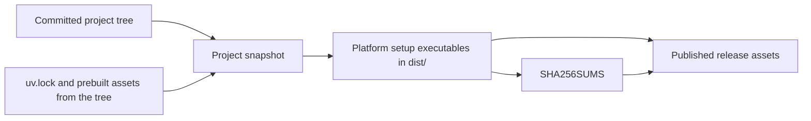
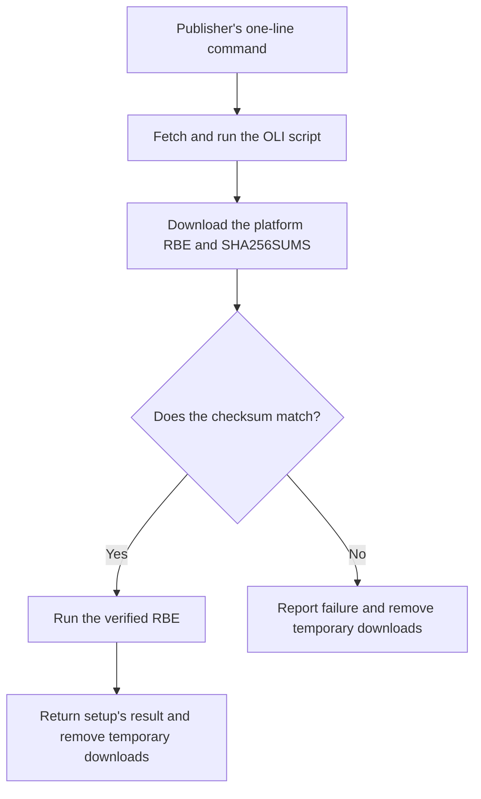
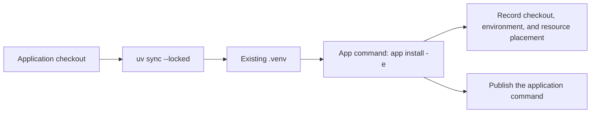
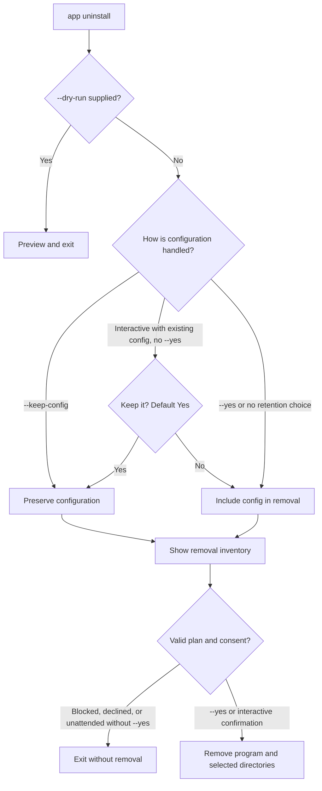

# How-to user guides

[Documentation](README.md) · [Explanations](Explanations.md) · [References](References.md) · [Examples](EXAMPLES.md) · [Development](Development.md)

- [Define and load settings](#define-and-load-settings)
  - [Read typed settings](#read-typed-settings)
  - [Declare an API key](#declare-an-api-key)
  - [Load dotenv files](#load-dotenv-files)
  - [Ship defaults with the application](#ship-defaults-with-the-application)
  - [Find where a value came from](#find-where-a-value-came-from)
- [Save preferences](#save-preferences)
  - [Save a user preference](#save-a-user-preference)
  - [Use AppRC inside an importable client](#use-apprc-inside-an-importable-client)
  - [Edit or remove a saved override](#edit-or-remove-a-saved-override)
- [Choose and initialize application paths](#choose-and-initialize-application-paths)
  - [Select a workspace](#select-a-workspace)
  - [Choose a layout from bootstrap inputs](#choose-a-layout-from-bootstrap-inputs)
  - [Supply application maintenance operations](#supply-application-maintenance-operations)
- [Give users configuration tools](#give-users-configuration-tools)
  - [Add configuration commands to Typer](#add-configuration-commands-to-typer)
  - [Launch the optional Textual application screen](#launch-the-optional-textual-application-screen)
  - [Handle eager version without preparing runtime state](#handle-eager-version-without-preparing-runtime-state)
  - [Preview and apply a purge](#preview-and-apply-a-purge)
  - [Inspect and edit settings in the terminal](#inspect-and-edit-settings-in-the-terminal)
  - [Save and repair secret settings](#save-and-repair-secret-settings)
  - [Add a Gradio settings page](#add-a-gradio-settings-page)
- [Prepare a release package](#prepare-a-release-package)
  - [Build a Windows installer](#build-a-windows-installer)
  - [Install a preview or run a smoke test](#install-a-preview-or-run-a-smoke-test)
  - [Validate installation on your machine](#validate-installation-on-your-machine)
  - [Generate one-line install scripts](#generate-one-line-install-scripts)
- [Install and recover applications](#install-and-recover-applications)
  - [Run a published installer](#run-a-published-installer)
  - [Install from a checkout](#install-from-a-checkout)
  - [Install from a Source Build](#install-from-a-source-build)
  - [Run the installed application](#run-the-installed-application)
  - [Update an application](#update-an-application)
  - [Keep or switch the saved layout](#keep-or-switch-the-saved-layout)
  - [Inspect or repair installation](#inspect-or-repair-installation)
  - [Remove a managed program](#remove-a-managed-program)
- [Use settings across application code](#use-settings-across-application-code)
  - [Pass several settings sections together](#pass-several-settings-sections-together)
  - [Import settings from a dependency](#import-settings-from-a-dependency)
  - [Reload settings or use temporary overrides](#reload-settings-or-use-temporary-overrides)
  - [Supply settings to environment-only code](#supply-settings-to-environment-only-code)
  - [Generate a config package](#generate-a-config-package)
- [Diagnose and migrate](#diagnose-and-migrate)
  - [Troubleshoot configuration](#troubleshoot-configuration)
  - [Migrate existing applications](#migrate-existing-applications)

Each guide is independent. Install AppRC using the [installation instructions](../README.md#installation).
The Python examples run on Python 3.12 or newer. Examples using temporary
directories remove their files when they finish. CLI guides explicitly identify
the files they keep in the working directory.

<br>

# Define and load settings

<a id="integrate-typed-settings"></a>
## Read typed settings

Define a [config section](Explanations.md#config-sections-and-fields), register it
on one [`AppRC`](Explanations.md#apprc), and build its settings from a
[`ResolvedConfig`](Explanations.md#resolvedconfig). Save this as `demo.py` and run
`python demo.py`:

<!-- example-file: demo.py -->
```python
import apprc as rc

MyRC = rc.AppRC(app_id="demo")

@MyRC.config("client", prefix="DEMO_")
class ClientSettings(rc.Config):
    timeout: int = rc.field("DEMO_TIMEOUT", default=30)


def request_timeout(settings: ClientSettings) -> int:
    return settings.timeout


resolved = MyRC.resolve(environment={"DEMO_TIMEOUT": "10"})
settings = resolved.build(ClientSettings)
assert request_timeout(settings) == 10
print(settings.timeout)
```

It prints `10`. The input is a string, but the field annotation makes the
application receive an integer. Passing an explicit environment mapping keeps
this example independent of your shell. Omit `environment` to use process
values. The [minimal setup](EXAMPLES.md#settings-without-managed-files) also shows
how separate resolutions retain their own values.

## Declare an API key

Use a required [config field](References.md#config-fields) with `secret=True`.
The application receives the value; AppRC's display helpers redact it. Save this
as `demo.py` and run `python demo.py`. The example value is a placeholder, not a
credential.

<!-- example-file: demo.py -->
```python
import apprc as rc

MyRC = rc.AppRC(app_id="demo")

@MyRC.config("client", prefix="DEMO_")
class ClientSettings(rc.Config):
    token: str = rc.field(
        "DEMO_TOKEN",
        required=True,
        secret=True,
        title="API token",
        explanation_short="Token used to authenticate API requests.",
        explanation_long="Obtain a token from your API provider and supply DEMO_TOKEN.",
    )

settings = MyRC.resolve(environment={"DEMO_TOKEN": "example-placeholder"}).build(ClientSettings)
assert settings.token == "example-placeholder"
assert settings.provenance_of("token").display_value == "<redacted>"
print(settings.provenance_of("token").display_value)
```

It prints `<redacted>`. Without `DEMO_TOKEN`, `build()` reports a missing required
field. The flag does not encrypt dotenv files or install a credential store.
When displaying [provenance](Explanations.md#provenance), use `display_value`;
`value` and `ResolvedConfig.values` contain actual inputs.

<a id="load-dotenv-inputs"></a>
## Load dotenv files

Pass explicit files in [`ResolveOptions.env_files`](References.md#resolution).
This complete example creates a temporary file and removes it on exit:

<!-- example-file: demo.py -->
```python
from pathlib import Path
from tempfile import TemporaryDirectory
import apprc as rc

MyRC = rc.AppRC(app_id="demo")

@MyRC.config("client", prefix="DEMO_")
class ClientSettings(rc.Config):
    timeout: int = rc.field("DEMO_TIMEOUT", default=30)

with TemporaryDirectory() as directory:
    path = Path(directory) / "deployment.env"
    path.write_text("DEMO_TIMEOUT=20\n", encoding="utf-8")
    environment = {"DEMO_TIMEOUT": "10"}
    normal = MyRC.resolve(rc.ResolveOptions(env_files=(path,)), environment=environment)
    file_first = MyRC.resolve(
        rc.ResolveOptions(env_files=(path,), env_file_overrides_os_environ=True),
        environment=environment,
    )
    assert normal.build(ClientSettings).timeout == 10
    assert file_first.build(ClientSettings).timeout == 20
    print("environment wins: 10; explicit file wins: 20")
```

Run it with `python demo.py`. By default, the process environment has higher
priority than explicit files. The option above reverses those two priorities.
Later explicit files win over earlier files. The
[layer explanation](Explanations.md#configuration-layers) and
[precedence reference](References.md#source-precedence) describe the other layers.
The [complete CLI example](EXAMPLES.md#explicit-dotenv-precedence) exposes the
same choice as command-line options.

## Ship defaults with the application

Set `config_package` to an importable Python package containing
`apprc.defaults.env`. For a source-run example, create these files in a new
working directory:

```text
working-directory/
  demo.py
  demo_config/
    __init__.py
    apprc.defaults.env
```

`demo_config/__init__.py`:

<!-- example-file: demo_config/__init__.py -->
```python
"""Packaged defaults for the example."""
```

`demo_config/apprc.defaults.env`:

<!-- example-file: demo_config/apprc.defaults.env -->
```dotenv
DEMO_TIMEOUT=20
```

`demo.py`:

<!-- example-file: demo.py -->
```python
import apprc as rc

MyRC = rc.AppRC(app_id="demo", config_package="demo_config")

@MyRC.config("client", prefix="DEMO_")
class ClientSettings(rc.Config):
    timeout: int = rc.field("DEMO_TIMEOUT", default=30)

settings = MyRC.resolve(environment={}).build(ClientSettings)
assert settings.timeout == 20
assert settings.provenance_of("timeout").resource == ("demo_config", "apprc.defaults.env")
print(settings.timeout)
```

Run `python demo.py` from that directory. It prints `20`: the packaged default
replaces the Python fallback. When distributing your app, include the dotenv
file as package data. For setuptools, this fragment belongs in the application's
`pyproject.toml`:

```toml
[tool.setuptools.package-data]
demo_config = ["apprc.defaults.env"]
```

The existing [precedence example package](../examples/example_apps/src/explicit_env_precedence/config/apprc.defaults.env)
contains a real packaged file. Missing optional packaged defaults contribute no
values, but an unimportable `config_package` is an error. Archive resources retain
[package provenance](References.md#provenance-and-lifecycle) after loading.

## Find where a value came from

Call [`provenance_of()`](References.md#provenance-and-lifecycle) on the settings
object. The argument is the Python field name, not its environment key. Run this
complete `demo.py`:

<!-- example-file: demo.py -->
```python
from pathlib import Path
from tempfile import TemporaryDirectory
import apprc as rc

MyRC = rc.AppRC(app_id="demo")

@MyRC.config("client", prefix="DEMO_")
class ClientSettings(rc.Config):
    timeout: int = rc.field("DEMO_TIMEOUT", default=30)

with TemporaryDirectory() as directory:
    path = Path(directory) / "deployment.env"
    path.write_text("DEMO_TIMEOUT=20\n", encoding="utf-8")
    settings = MyRC.resolve(rc.ResolveOptions(env_files=(path,)), environment={}).build(ClientSettings)
    origin = settings.provenance_of("timeout")
    assert origin.origin == "shell_dotenv_explicit"
    assert origin.path == path
    assert origin.display_value == 20
    print(origin.origin)
```

It prints `shell_dotenv_explicit`. [Provenance](Explanations.md#provenance) also
records Python defaults and overrides. The [config editor](Explanations.md#config-editor)
lets users compare source values without writing Python inspection code.

<br>

# Save preferences

<a id="set-up-persistence"></a>
## Save a user preference

Enable a [user dotenv](Explanations.md#user-dotenv) together with the config
component. This example uses a temporary single-root layout:

<!-- example-file: demo.py -->
```python
from pathlib import Path
from tempfile import TemporaryDirectory
import apprc as rc

with TemporaryDirectory() as directory:
    MyRC = rc.AppRC(
        app_id="demo",
        paths=rc.Paths(config=True),
        layout=rc.Layout.single_root(Path(directory)),
        user_dotenv=rc.UserDotenv(),
    )

    @MyRC.config("client", prefix="DEMO_")
    class ClientSettings(rc.Config):
        timeout: int = rc.field("DEMO_TIMEOUT", default=30)

    manager = MyRC.manage(environment={})
    manager.setup()
    manager.apply_edit(manager.plan_update("client.timeout", "20", scope="user"))
    config_dir = MyRC.paths().require("config")
    assert (config_dir / "apprc.user.env").is_file()
    assert manager.resolve().build(ClientSettings).timeout == 20
    print("saved timeout: 20")
```

`UserDotenv()` does not enable config; `Paths(config=True)` declares that
component. `setup()` initializes only user configuration. The user dotenv path
comes from the resolved config directory, not a separate `apprc_dir` override.
Reading settings does not create a missing dotenv.

<a id="edit-saved-values"></a>
## Use AppRC inside an importable client

A library can own its [`AppRC`](Explanations.md#apprc) declaration and load
settings when a client is constructed. Its caller then imports `Client` and does
not need to declare AppRC or call a setup function. This example uses a
[config section](Explanations.md#config-sections-and-fields), packaged defaults,
and a [user dotenv](Explanations.md#user-dotenv).

Create these files in one working directory:

```text
working-directory/
  demo.py
  myclient/
    __init__.py
    client.py
    config.py
    apprc.defaults.env
```

`myclient/__init__.py`:

<!-- example-file: myclient/__init__.py -->
```python
"""Public imports for the example client."""

from myclient.client import Client
```

`myclient/config.py`:

<!-- example-file: myclient/config.py -->
```python
import apprc as rc

MyRC = rc.AppRC(
    app_id="demo",
    config_package="myclient",
    paths=rc.Paths(config=True),
    bootstrap_env_prefix="DEMO",
    user_dotenv=rc.UserDotenv(),
)


@MyRC.config("client", prefix="DEMO_")
class ClientSettings(rc.Config):
    timeout: int = rc.field("DEMO_TIMEOUT", default=30)
```

`myclient/apprc.defaults.env`:

<!-- example-file: myclient/apprc.defaults.env -->
```dotenv
DEMO_TIMEOUT=20
```

`myclient/client.py`:

<!-- example-file: myclient/client.py -->
```python
from myclient.config import ClientSettings, MyRC

class Client:
    def __init__(self, settings: ClientSettings | None = None) -> None:
        self.settings = settings if settings is not None else MyRC.resolve().build(ClientSettings)

    @property
    def timeout(self) -> int:
        return self.settings.timeout
```

`demo.py` creates a disposable user dotenv so the example does not touch your
normal AppRC directory. The only import needed for ordinary client use is
`Client`:

<!-- example-file: demo.py -->
```python
import os
from pathlib import Path
from tempfile import TemporaryDirectory
from myclient import Client

with TemporaryDirectory() as directory:
    os.environ["DEMO_LAYOUT"] = "single-root"
    os.environ["DEMO_ROOT"] = directory
    config_dir = Path(directory) / "config"
    config_dir.mkdir()
    (config_dir / "apprc.user.env").write_text("DEMO_TIMEOUT=15\n", encoding="utf-8")
    assert Client().timeout == 15

    os.environ["DEMO_TIMEOUT"] = "10"
    assert Client().timeout == 10
    print("user: 15; process: 10")
```

Run `python demo.py`. The demonstration script writes `apprc.user.env`; importing
or constructing `Client` does not write it. Each construction calls
[`resolve().build()`](References.md#resolution), so a new client sees a changed
user dotenv while an existing client keeps its settings. The process value wins
over the file values. Pass an already built `ClientSettings` to share one
[`ResolvedConfig`](Explanations.md#resolvedconfig) across clients or to inject
settings in a test. Include `apprc.defaults.env` as package data when building
a wheel, as shown in [Ship defaults with the application](#ship-defaults-with-the-application).
The [complete importable-client example](EXAMPLES.md#importable-client-with-saved-preferences)
also provides configuration commands for users.

## Edit or remove a saved override

An edit plan identifies the target file and proposed assignment. A preview
shows the effective configuration after that edit, including higher-priority
values that might still win. Run this independent `demo.py`:

<!-- example-file: demo.py -->
```python
from pathlib import Path
from tempfile import TemporaryDirectory
import apprc as rc

with TemporaryDirectory() as directory:
    MyRC = rc.AppRC(
        app_id="demo",
        paths=rc.Paths(config=True),
        layout=rc.Layout.single_root(Path(directory)),
        user_dotenv=rc.UserDotenv(),
    )

    @MyRC.config("client", prefix="DEMO_")
    class ClientSettings(rc.Config):
        timeout: int = rc.field("DEMO_TIMEOUT", default=30)

    manager = MyRC.manage(environment={})
    manager.setup()
    plan = manager.plan_update("client.timeout", "20", scope="user")
    preview = manager.preview_edit(plan)
    assert preview.ready
    manager.apply_edit(plan)
    assert manager.resolve().build(ClientSettings).timeout == 20
    removal = manager.plan_removal("client.timeout", scope="user")
    assert removal is not None
    manager.apply_edit(removal)
    assert manager.resolve().build(ClientSettings).timeout == 30
    print("removed override; timeout is 30 again")
```

Removing the saved assignment restores the next value in
[source precedence](References.md#source-precedence). Edits preserve unrelated
comments and formatting. Duplicate assignments are reported for cleanup.

`apply_edit()` raises [`StaleEditError`](References.md#errors-and-write-guarantees)
if the target file changed after planning. Inspect again and create a new plan;
do not retry the old one. Explicit `scope="user"` can create a missing user
dotenv. Workspace edits require a selected workspace. The
[user/workspace setup](EXAMPLES.md#user-preferences-and-workspaces) demonstrates both scopes.

<br>

# Choose and initialize application paths

Declare the components the application actually uses. This complete `demo.py`
uses only cache and writes no files until `ensure_path()` is called:

<!-- example-file: demo.py -->
```python
from pathlib import Path
from tempfile import TemporaryDirectory
import apprc as rc

with TemporaryDirectory() as directory:
    MyRC = rc.AppRC(
        app_id="cache-demo",
        paths=rc.Paths(cache=True),
        layout=rc.Layout.single_root(Path(directory)),
    )
    inspected = MyRC.paths()
    assert inspected.config_dir is None
    assert inspected.cache_dir == Path(directory) / "cache"
    assert not inspected.cache_dir.exists()
    cache_dir = MyRC.ensure_path("cache")
    assert cache_dir.is_dir()
    assert (cache_dir / ".apprc-owner.json").is_file()
    assert not (Path(directory) / "config").exists()
    print("only cache initialized")
```

`Paths` enables config, appdata, cache, and state separately. `AppPaths` returns
absolute paths for enabled components and `None` for disabled components.
`paths()` is zero-write; `ensure_path(kind)` creates only the requested
component and records ownership. See the [component explanation](Explanations.md#application-paths)
and [API reference](References.md#application-paths).

For native locations use `Layout.native()`. To colocate enabled roots use
`Layout.single_root(root)`, which resolves the root against invocation current
working directory. `ensure_path("state")` does not create logs; use
`ensure_path("logs")` to initialize the subordinate log path.

If a category root already contains files without an owner marker, the safe
default is refusal. `ensure_path("config", adopt=True)` explicitly adopts a
nonempty unowned config root without moving or deleting its contents. `config
setup --adopt` provides the same explicit choice through the CLI. Other resource
initialization remains a Python `ensure_path()` operation, not a resource `init`
command. Do not use adoption to make AppRC claim files you do not control.

## Select a workspace

Declare `Workspaces()` when users need named working directories. This complete
script demonstrates registration and selection; the registry is in the enabled
config root, while the workspace payload is separate:

<!-- example-file: demo.py -->
```python
from pathlib import Path
from tempfile import TemporaryDirectory
import apprc as rc

with TemporaryDirectory() as directory:
    root = Path(directory)
    MyRC = rc.AppRC(
        app_id="demo",
        paths=rc.Paths(config=True),
        layout=rc.Layout.single_root(root / "app"),
        workspaces=rc.Workspaces(),
    )
    MyRC.ensure_path("config")
    manager = MyRC.workspaces(environment={})
    manager.register_workspace("work", root / "work")
    manager.select_workspace("work")
    before = MyRC.resolve(environment={})
    assert before.workspace is not None
    assert before.workspace.workspace_name == "work"
    assert before.paths.config_dir == root / "app" / "config"
    print(before.workspace.root)
```

Selection changes the workspace settings overlay and root, not the captured
`AppPaths`. `WorkspaceManager` owns registration, selection, rename, repoint,
move, remove, archive, and restore. Unregistering never deletes workspace
payloads. The [workspace reference](References.md#workspace-selection) defines
selector precedence and direct paths. Repointing to an existing directory
creates the ordinary workspace settings file if it is missing. Registration
and restore can complete with a private companion warning. To enable private
workspace overrides, review the reported path and use
[secret permission repair](#save-and-repair-secret-settings).

To move a registered workspace, run `demo workspace move NAME DESTINATION`
using your application's command in place of `demo`. The command prints the
new root when the registry is updated. If cleanup leaves a directory in place,
the command reports it on stderr and still returns success for the completed
move. If the workspace was repointed while the move waited, review its
registered root and retry.

For research software, record the application release and project settings
alongside the input data, analysis parameters, and validation decisions.

`Workspaces(registry=False)` permits direct path selection without config or a
registry. Relative paths resolve against invocation current working directory;
a bare value supplied as a workspace selector fails because names require a
registry. The explicit `WorkspaceManager.initialize_workspace(root)` path
argument may be any relative path, including `Path("demo-workspace")`. Initialize
the directory before selecting it. This creates `apprc.workspace.env` in the
root, without config or registry writes; the secret companion is created only
if needed. The direct mode does not persist named registration:

```python
from pathlib import Path
import apprc as rc

MyRC = rc.AppRC(
    app_id="demo",
    workspaces=rc.Workspaces(registry=False),
)
manager = MyRC.workspaces(environment={})
root = Path("demo-workspace")
manager.initialize_workspace(root)
selected_root = manager.select_workspace("./demo-workspace")
assert selected_root == root.resolve()
```

Run the CLI form with:

```shell
python demo.py workspace init ./demo-workspace
python demo.py workspace info ./demo-workspace
```

The CLI exposes the same setup and inspection as `workspace init PATH` and
`workspace info PATH`. Both take an explicit root path; they do not enable config
or write a registry. Registry-backed workspaces continue to use named
registration and selection.

## Choose a layout from bootstrap inputs

With `bootstrap_env_prefix="DEMO"` the bootstrap pair is `DEMO_LAYOUT` and
`DEMO_ROOT`. AppRC selects both values from one winning raw layer: root alone
means single-root; `native` plus a root in that same layer is invalid; a higher
layer's `native` ignores a lower layer's root. Invocation `Layout` overrides
these inputs. Explicit dotenv files are separate layers, and their ordering
relative to process environment follows `env_file_overrides_os_environ`.
`AppPaths.source` records which layer supplied the chosen layout.

These are invocation controls, not a persistent layout setter. A valid saved
installation record supplies placement when no invocation/environment control
wins, before the source declaration. Use the application's
[installer layout choice](#keep-or-switch-the-saved-layout) to persist a switch;
do not put relocation controls into the managed user dotenv it would relocate.

## Supply application maintenance operations

Application backup, restore, cache pruning, state reset, and semantic purge
require explicit provider handlers. Supply `MaintenanceHandlers` to
`MyRC.maintain(...)` and to the CLI mount. Supported operations appear under
`app data backup/restore`, `app cache prune/clear`, and `app state prune/reset`;
absent operations are not mounted. An enabled path alone does not create a
resource command group. An app-specific provider owns its database format,
leases, and coordination; AppRC validates ownership, boundaries, exact target
lists, and plan revisions before dispatch.

Purge is not recursive cleanup. It previews exact AppRC-managed files and empty
directories, refuses unknown contents and unsafe links, and reports partial
results. It never includes workspace payloads or package caches, and multiple
roots are not deleted atomically. See [maintenance contracts](References.md#maintenance).
<br>

# Give users configuration tools

<a id="integrate-a-terminal-application"></a>
## Add configuration commands to Typer

`mount_app_cli` provides the high-level integration: it owns the Typer callback,
captures bootstrap options, and prepares business settings only for commands
that need them. This complete `demo.py` configures user preferences and a
single-root layout:

<!-- example-file: demo.py -->
```python
import apprc as rc
import typer

MyRC = rc.AppRC(
    app_id="demo",
    paths=rc.Paths(config=True),
    layout=rc.Layout.single_root("demo-config"),
    user_dotenv=rc.UserDotenv(),
)

@MyRC.config("client", prefix="DEMO_")
class ClientSettings(rc.Config):
    timeout: int = rc.field("DEMO_TIMEOUT", default=30)

app = typer.Typer(cls=rc.cli.AppRCRootGroup)
rc.cli.mount_app_cli(app, MyRC)

@app.command()
def run(ctx: typer.Context) -> None:
    state = rc.cli.state_from(ctx, rc.cli.DefaultConfigCliState)
    assert state.resolved is not None
    typer.echo(state.resolved.build(ClientSettings).timeout)

if __name__ == "__main__":
    app()
```

Run from the directory containing `demo.py`:

```shell
python demo.py --help
python demo.py app paths config
python demo.py config setup --yes
python demo.py config set client.timeout 20 --scope user
python demo.py run
python demo.py app doctor --json
```

`app paths config` prints its absolute path without creating it. `config setup
--yes` initializes only configuration and the managed user dotenv without
interactive preference prompts. Add `--adopt` only to claim a nonempty unowned
config directory you control. The edit is saved in
`demo-config/config/apprc.user.env`; `run` then prints `20`.

`AppRCRootGroup` groups root help under `Commands`, `Options`,
`AppRC: Commands`, `AppRC: Runtime Options`, and `Help & Completion`, in
that order. AppRC omits empty panels. Ordinary Typer roots
remain supported, and nested help uses normal Typer formatting. Repeat
`--env-file` to load multiple files in order. The other runtime options are
`--env-file-overrides-os-environ`/`-o`, `--skip-dotenv-layers`/`-s`,
`--workspace`, `--layout`, `--app-root`, and `--log-level`.
`-o` changes explicit-file versus OS-environment priority.
`-s` skips dotenv setting values, including values from explicit files. Those
files still participate in path and workspace selection. Layout and root overrides
apply to this invocation only. Log-level handling still occurs before resolution.

The mount adds `app doctor` and `app paths` even without config or resource
declarations. `config` and `workspace` depend on their declarations. Set
`maintenance_group_name="app"` to choose the maintenance group's name (the
default shown here), and `maintenance_help_panel="AppRC: Commands"` to choose
its root-help panel. Set `installation_management=True` to enable
`app install -e`.
For a Source Build, enable distribution authoring in the checkout or supply an
explicit `installer_entrypoint`. See the [command reference](References.md#terminal-commands).

The returned group mapping uses actual mounted paths: `config`, `workspace`,
`app`, and, when nonempty, `app.data`, `app.cache`, and `app.state`. A renamed
maintenance group changes that prefix. There are no flat `appdata`, `cache`,
or `state` aliases.

Register host resource commands with `resource_group_extensions` while mounting,
not by adding commands to the returned mapping afterward. Each key must name a
declared resource category; its callback receives that detached resource Typer
group before empty-group filtering:

```python
def register_cache_commands(group: typer.Typer) -> None:
    @group.command("inspect")
    def inspect_cache() -> None:
        typer.echo("Application cache inspection")


groups = rc.cli.mount_app_cli(
    app,
    MyRC,
    resource_group_extensions={"cache": register_cache_commands},
)
```

This excerpt requires `MyRC` to declare `Paths(cache=True)`. A callback cannot
create a group for an undeclared category. See the exact
[mounting contract](References.md#composition-arguments).

A high-level mount rejects an existing root callback. If the application owns
that callback, use `CliRuntime.mount_app_groups()` and call
`CliRuntime.prepare()` in the callback. Maintenance and workspace routes do not
build host business state; nested help and recovery must remain usable with
broken business configuration or installation authority. See the
[callback example](EXAMPLES.md#an-application-owned-cli-callback).

Keep command declarations lightweight: import database, browser and provider
implementations inside their command or maintenance callback. AppRC defers its
own editors and interactive prompts. Follow the [startup boundary and fresh-process
checks](Development.md#lightweight-cli-startup), including parent-package facades.

## Launch the optional Textual application screen

Replace the earlier `rc.cli.mount_app_cli(app, MyRC)` line in `demo.py` with
this call. AppRC's Textual launcher remains optional; the host supplies a
`LauncherSpec` and optional handlers:

```python
from apprc.interfaces.tui import LauncherAction, LauncherSpec

rc.cli.mount_app_cli(
    app,
    MyRC,
    launcher_spec=LauncherSpec(
        actions=(
            LauncherAction(
                id="run",
                label="Run demo",
                argv=lambda _context, _dry_run: ("python", "demo.py", "run"),
            ),
        ),
        title="Demo",
    ),
)
```

Add `launcher_handlers` only when an action needs a host callback. It maps
action IDs to callbacks; a handler receives captured launcher context and a
dry-run flag. The `launch` command is mounted only when `launcher_spec` is
provided. It does not replace the application's foreground `run` command or
create a saved app-launch entry. See the [launcher reference](References.md#launcher).

## Handle eager version without preparing runtime state

When the host owns the root callback, an eager boolean callback can print
version metadata and exit before calling `runtime.prepare()`. This prevents a
metadata-only query from resolving application paths or business settings.
Declare the host callback first, then construct `CliRuntime` and mount groups:

```python
def version_callback(value: bool) -> bool:
    if value and not typer.get_current_context().resilient_parsing:
        typer.echo("demo 1.0.0")
        raise typer.Exit()
    return value


@app.callback()
def host_callback(
    ctx: typer.Context,
    version: bool = typer.Option(
        False,
        "--version",
        "-V",
        callback=version_callback,
        is_eager=True,
    ),
    env_files: rc.cli.EnvFilesOption = None,
    env_file_overrides_os_environ: rc.cli.EnvFileOverridesOption = False,
    skip_dotenv_layers: rc.cli.SkipDotenvLayersOption = False,
    workspace: rc.cli.WorkspaceOption = None,
    layout: rc.cli.LayoutOption = None,
    app_root: rc.cli.AppRootOption = None,
    log_level: rc.cli.LogLevelOption = None,
) -> None:
    del version
    options = rc.cli.CliRuntimeOptions.from_typer(
        env_files=env_files,
        env_file_overrides_os_environ=env_file_overrides_os_environ,
        load_dotenv_layers=not skip_dotenv_layers,
        workspace=workspace,
        layout=layout,
        app_root=app_root,
        log_level=log_level,
    )
    runtime.prepare(ctx, options)
```

This is an excerpt: create `app = typer.Typer(cls=rc.cli.AppRCRootGroup)` and
`runtime = rc.cli.CliRuntime(MyRC)` before registering the callback, then call
`runtime.mount_app_groups(app, ...)` after its definition. Supply composition
options such as `handlers`, `installation_management`,
`installer_entrypoint`, and `launcher_spec` to `mount_app_groups()`. The seven
AppRC option annotations preserve the normal root controls; logging is captured
before business resolution. The high-level `mount_app_cli()` owns its callback,
so use this host-owned route when adding an eager option. See
[runtime options and callback composition](References.md#root-help-and-runtime-options).

## Preview and apply a purge

Purge remains a Python maintenance service, not an app-facing CLI command or
alias. Obtain a `MaintenanceManager` with `MyRC.maintain()`, preview its exact
plans, obtain the application's explicit consent, and apply those same plans.
This complete `demo.py` initializes only an empty temporary cache and displays
its plan before asking permission:

<!-- example-file: demo.py -->
```python
from pathlib import Path
from tempfile import TemporaryDirectory
import sys
import apprc as rc

with TemporaryDirectory() as directory:
    MyRC = rc.AppRC(
        app_id="purge-demo",
        paths=rc.Paths(cache=True),
        layout=rc.Layout.single_root(Path(directory)),
    )
    MyRC.ensure_path("cache")
    manager = MyRC.maintain(environment={})
    plans = manager.plan_purge(("cache",))

    for plan in plans:
        print(plan)
    if sys.stdin.isatty() and input("Apply these exact cache plans? [y/N] ").strip().lower() == "y":
        for result in manager.apply_purge(plans):
            print(result)
```

Run `python demo.py`; enter `y` to apply or leave the answer empty to decline.
The temporary directory is removed on exit either way. Real applications must
keep backups outside selected roots and supply their own consent and result
presentation. A missing category directory has an empty plan and is not
initialized by planning. An explicitly disabled category is invalid.

Plans carry exact targets and revisions, not recursive cleanup instructions.
Unknown files, unsafe links, changed revisions, or unowned nonempty roots block
unsafe deletion. `apply_purge()` revalidates all supplied plans before dispatch;
multi-root application is not atomic, so inspect returned removed/skipped
targets and warnings rather than assuming rollback. Workspace payloads and
package caches are never implicit targets. Application-specific purge semantics
still use the existing provider handlers. See the
[maintenance service reference](References.md#maintenance).

## Inspect and edit settings in the terminal

Use the [user preferences example](EXAMPLES.md#persistent-user-preferences) to
try the Textual editor. The editor can show defaults, explicit files, and
environment values beside saved overrides. A higher-priority process value can
still win after a successful file edit. Workspace browsing is independent of
the saved selected workspace; see the [editor explanation](Explanations.md#config-editor).

Opening the editor creates no files. Setup and save actions call
`ConfigManager`; workspace selection and registry operations use
`WorkspaceManager`.

## Save and repair secret settings

Mark a [config field](Explanations.md#config-sections-and-fields) with
`secret=True` to redact display output and route managed writes to a private
companion. This example uses the config layer and selected workspace layer:

<!-- example-file: demo.py -->
```python
from pathlib import Path
from tempfile import TemporaryDirectory
import apprc as rc

with TemporaryDirectory() as directory:
    root = Path(directory)
    MyRC = rc.AppRC(
        app_id="demo",
        paths=rc.Paths(config=True),
        layout=rc.Layout.single_root(root / "app"),
        user_dotenv=rc.UserDotenv(),
        workspaces=rc.Workspaces(),
    )

    @MyRC.config("client", prefix="DEMO_")
    class ClientSettings(rc.Config):
        token: str = rc.field("DEMO_TOKEN", default="", secret=True)

    MyRC.ensure_path("config")
    workspaces = MyRC.workspaces(environment={})
    workspaces.register_workspace("work", root / "work")
    workspaces.select_workspace("work")
    manager = MyRC.manage(environment={})
    manager.setup()
    manager.apply_edit(manager.plan_update("DEMO_TOKEN", "user-example", scope="user"))
    manager.apply_edit(manager.plan_update("DEMO_TOKEN", "workspace-example", scope="workspace"))
    assert manager.writable_path("user", secret=True).name == "apprc.user.secret.env"
    assert manager.writable_path("workspace", secret=True).name == "apprc.workspace.secret.env"
    assert manager.resolve().build(ClientSettings).token == "workspace-example"
```

The current secret migration/repair commands concern secret assignments only;
they do not migrate old layout or registry formats. Inspect `config secrets
status` before explicitly migrating existing secrets. Do not rename old storage
files to the new workspace filenames.

## Add a Gradio settings page

Install `apprc-gui` alongside the application. The editor receives a
`ConfigManager`; provide a separate `WorkspaceManager` when registry-backed
workspace controls are needed:

```python
import gradio as gr
from apprc_gui import ConfigEditor

from my_app.config import MyRC

manager = MyRC.manage()
workspaces = MyRC.workspaces()  # only when Workspaces(registry=True) is declared
with gr.Blocks() as page:
    gr.Markdown("# My App")
    with gr.Tab("Settings"):
        ConfigEditor(manager, workspace_manager=workspaces).render()

page.launch(server_name="127.0.0.1", share=False)
```

Config-only applications can pass just `manager`. Registry-backed workspace
controls require a workspace manager. An explicit browser selection updates the
saved application default and keeps that selection for the current session.
Sessions without an explicit selection follow the configured or saved selection
when they render. Built-in workspace controls edit the directory inspected for
that view. If a name is repointed while a view is open, refresh the page before
editing the new directory.
The application owns the start callback and builds its runtime only after
`manager.inspect().ready`.

For a host-owned section, pass `section_renderers={owner_key: callback}`.
The callback receives `ConfigSectionContext` and replaces that owner's field
controls. Use `manager.plan_updates(values, scope=...)` followed by
`manager.apply_updates(plan)` to save related fields together, then perform
application-specific validation after the write locks have been released.
Other sections keep the standard editor controls and source visibility.


<br>

# Prepare a release package

## Build a Windows installer

Use the same authored project-snapshot/native build as for Linux. Declare
`runtime-python` and the primary `command-name` under
`[tool.apprc.distribution]`; compose the public
[distribution builders](References.md#distribution-generation) in the
application's `<app>_distr` build command.

Set up the [native setup toolchain](Development.md#native-setup-toolchain),
then run the application's `just make-artifacts` recipe. Its ignored `dist/`
contains Windows and Linux setup executables plus `SHA256SUMS`; intermediates
stay in `.cache/apprc/`. The Windows setup installs the same stable native command
used for diagnosis, repair and uninstall.

The manifest covers the native executables produced by the build. AppRC embeds
the locked source snapshot and its digests in each executable so the installer
can verify the inputs it uses to prepare the application runtime.

**Release package inputs and outputs**



If the application declares an [authoring backend](References.md#distribution-generation),
run `uv run --locked <app> dist build` and `uv run --locked <app> dist check`
from the checkout. With `AppRCRootGroup`, root help lists `dist` under
**AppRC: Commands**. Add `-t` for just the current platform. With installation
management enabled, `uv run --locked <app> app install` verifies and runs the
current-platform setup. Builds use the committed tree, so commit changes you
want to include before building. If a setup and its manifest disagree, inspect
or move the old artifact set out of `dist/` before rebuilding.

For a hybrid application, build static frontend assets on the private authoring
copy and include them in Python package data before snapshotting. Do not bundle
a custom wheelhouse or require Bun/React build tools on the recipient. Normal uv
dependency acquisition can still need network access and private Git credentials;
this is not an offline installer guarantee.

> [!WARNING]
> Cross-compiling a Windows executable does not establish native Windows
> installation, shortcuts, updates or self-removal. Windows/macOS validation is
> deferred. Never launch native Windows test executables from WSL; follow the
> separately authorized native validation procedure.

## Install a preview or run a smoke test

An opted-in native setup installs a preview alongside the regular application.
Use the setup from a verified release and pass `--preview` or `--smoke` as
the first option.

| Command | Result |
| --- | --- |
| `<setup> --preview` | Install or update the preview and leave it installed. |
| `<setup> --regular` | Install or replace the regular application on a setup that supports the prerelease preview default. |
| `<setup> --smoke` | Install a fresh preview, verify its runtime, and wait for uninstall to finish. |
| `<preview-command> app uninstall` | Remove the preview through the ordinary uninstall workflow. |

When the publisher enables the preview default for beta and release candidate
builds, launching one of those setups directly selects Preview. Pass
`--regular` as the first option to select the regular installation explicitly.

From the installed managed command, choose a published version and install it
as Preview. Run update to apply a newer version to an existing Preview.

```shell
demo app install --preview --version 2.0.0b1
demo update --preview --version 2.0.0b2
```

Use `demo app update` if the root alias is disabled. Both commands also accept
`--release TAG` for exact release selection. Installation follows the setup's
replacement confirmation. The update command checks the existing preview
version and rejects downgrades.

On Windows, run the verified preview-enabled setup from its download directory
in PowerShell.

```powershell
.\demo-setup-windows-x86_64.exe --preview
```

For a path containing spaces, quote the path and invoke it with PowerShell's
call operator `&`.

```powershell
& "C:\My Downloads\demo-setup-windows-x86_64.exe" --preview
```

`-p` and `-s` are the short forms. Combining them runs smoke. A smoke test
requires an unused preview identity with no retained preview resources. If
you have preview data you want to keep, leave that preview installed. Preview
uses fixed native resource paths. On Linux, persistent preview needs an
existing command directory on PATH. Supply `--command-directory PATH` if the
default directory is unavailable.

With an updated OLI and release setup, append the setup options to Bash's
standard-input invocation. In PowerShell, download the script and invoke it
as a file to supply options.

```bash
curl -fsSL <PUBLIC_SCRIPT_URL> | bash -s -- --smoke
```

```powershell
Invoke-WebRequest -UseBasicParsing -Uri <PUBLIC_SCRIPT_URL> -OutFile .\install_from_github.ps1
& .\install_from_github.ps1 --smoke
```

## Validate installation on your machine

Run the guided validation from a checkout with distribution authoring and
installation management enabled, using its existing environment. Editable
registration is the default. Select `--managed/-m` to test a release
installation, or supply an older setup with `--update-from/-u`
to test an update. `--update-from` implies `--managed` and cannot be combined
with `--editable/-e`.

```shell
uv run --locked <app> dist test -e
uv run --locked <app> dist test -m
uv run --locked <app> dist test -m -u /absolute/path/to/old/<app-id>-setup-linux-x86_64
```

For Windows, use the old `<app-id>-setup-windows-x86_64.exe` and run the guide
under native Windows. Place the old release's `SHA256SUMS` beside that file.
Build and check the current artifact with `dist build -t` and `dist check -t`
before managed validation. Save your work and stop application consumers before
starting. The guide performs real installation and uninstallation on this
account.

If an installation already exists, review its displayed state and the normal
uninstall preview. Confirm only if you accept removal of the listed application
data. Declining exits. The guide then runs the selected lifecycle, asks for
manual launch and platform observations, and records the outcome under
`.cache/apprc/dist-test/`. Editable removal keeps the checkout and `.venv`.
Review any retained configuration before starting another full lifecycle.

Close the application and any servers started for the manual check before
continuing to the final uninstall. If cleanup reports that a resource is in
use, stop the process using it and resume the saved `app uninstall` before
running `dist test` again. Keep the configuration choice from the original
uninstall.

`uv run --locked <app> dist test -m -y` runs unattended automated checks only
when preflight permits them. A pre-existing personal installation stops this
invocation. Human observations remain NOT VERIFIED in its report. Follow any
reported recovery instructions if a step fails. See the
[guided validation contract](References.md#guided-installation-validation) for
profile flags and update checks.


## Generate one-line install scripts

From a checkout that provides `dist build`, pass the release repository and
access mode to the build. For example, with an application command named `demo`:

```bash
RELEASE_PUBLIC=true uv run --locked demo dist build --olis-repo OWNER/REPO
```

Replace `OWNER/REPO` with the GitHub repository that holds the native setup
executables and `SHA256SUMS`. Use `-o` as shorthand or export
`RELEASE_REPO_OLIS=OWNER/REPO` to set a default for builds. Set
`RELEASE_PUBLIC=false` for a private release.
A configured build writes `install_from_github.sh` and
`install_from_github.ps1` to `dist/`.

If neither repository setting is supplied, AppRC builds the executables and
reports that OLI generation was skipped. Host each script at a URL you control
and substitute that URL into the command template in its header. Publish the
checksummed native executables and `SHA256SUMS` to the configured GitHub
release repository. See the
[script and build settings](References.md#one-line-install-script-reference)
for the public and private prerequisites.

<br>

# Install and recover applications

<a id="install-and-recover-managed-applications"></a>

Use the application’s own command and release instructions. The examples use
`demo` as the command. See the [route and layout definitions](References.md#installation-terminology)
to choose the workflow that matches your starting point.

## Run a published installer

If the publisher provides a **One-line installer (OLI)**, copy the command
from the app’s trusted installation page. It fetches the app’s OLI script and
runs it in the current shell. The script finds the platform executable and
`SHA256SUMS` in the app’s latest published GitHub release, verifies the
executable, and then starts it. It uses the published assets even when the
application has newer changes on `main`.

**What the One-line installer runs**



To run a **Released Binary Executable (RBE)** directly, download the binary
for your platform and the matching `SHA256SUMS` from the same release.
For Linux, verify the local executable before making it runnable:

```shell
sha256sum --check --ignore-missing SHA256SUMS
```

Continue only if the output reports `demo-setup-linux-x86_64: OK`:

```shell
chmod +x demo-setup-linux-x86_64
./demo-setup-linux-x86_64
```

On Windows, run these commands in PowerShell from the download directory:

```powershell
Get-FileHash -Algorithm SHA256 .\demo-setup-windows-x86_64.exe
Get-Content .\SHA256SUMS | Select-String -SimpleMatch 'demo-setup-windows-x86_64.exe'
```

Compare the two hashes for that filename. If they match, double-click the
verified setup or run it from the same PowerShell session:

```powershell
& ".\demo-setup-windows-x86_64.exe"
```

Setup uses the snapshot inside the executable to prepare a private locked
runtime. Dependency acquisition can require network access and credentials.
Read the final result and any **Next step** the application supplies.
Double-clicked Windows setup keeps the result visible until you press Enter.
On failure, read the reported diagnostic log path if shown. Running setup
from an existing terminal also lets you inspect its exit code.

Run Windows setup from the account that will use the application. Setup
normally runs without administrator privileges. If Windows denies access to
the installation directory or its lock, use the named operation and path in
the setup output and the traceback in the diagnostic log to check permissions
from that account.

## Install from a checkout

An **Editable Source Checkout (eSC)** reuses your project and its existing
environment. AppRC prepares the registration and integrations after uv prepares
the environment.

**Editable registration from a checkout**



From the checkout, prepare the environment:

```shell
uv sync --locked
```

For a uv workspace member, activate the workspace root's `.venv` in the
following commands.

Activate the checkout environment on Linux or macOS:

```shell
source .venv/bin/activate
```

Or activate it in Windows PowerShell:

```powershell
.\.venv\Scripts\Activate.ps1
```

With that environment active, run:

```shell
demo app install -e
```

Alternatively, without activating the environment, run
`uv run --locked demo app install -e` from the checkout.

AppRC reports live progress as it validates your checkout, reuses its
environment, initializes resources, publishes the command, and saves the
installation record. Managed setup instead reports preparation of its own
runtime, including dependency synchronization when needed. Each route shows
the paths involved and ends with an explicit completion message on success.
Optional setup or Windows metadata failures are reported separately so you can
tell whether the app itself was installed.

On Windows, successful installation also attempts to set the global executable's
product version and add an entry to Windows Settings → Installed apps. Editable
checkouts appear there too. Selecting Uninstall follows the
[removal and retention guide](#remove-a-managed-program). Run `app install -e`
again after updating the app to refresh
Windows' displayed version; `uv sync` alone does not refresh it.

Version display is optional. A metadata failure produces a warning and leaves
the app installed. Windows' numeric executable version supports plain releases
such as `0.19.0`; unsupported versions retain the original launcher. The Installed
apps entry can display the full version string. `--version` remains the way to
ask the running application for its version.

The command reports the global command and checkout paths after installation.
On Windows, if replacing the global command is denied, stop running application
processes, including servers, and retry. If the denial persists, check file
permissions. If optional `config setup` fails, the global command remains
installed; run `demo config setup` to retry.

`uv sync --locked` prepares the repository's `.venv`; AppRC then
registers it and initializes only declared configuration/data/cache/state.
Registration does not create another environment, copy the repository, resolve
dependencies or take ownership of the checkout.

The registered global `demo` command uses that repository environment even when
another environment is active. Its command directory must already be on PATH;
`--command-directory PATH` can select another safe existing directory without
editing shell profiles. Unknown command collisions are errors, not replacements.

At the end, AppRC offers `config setup` only when active, editable user settings
are required, have no fallback, and remain missing after configuration resolution.
Workspace-only and already supplied settings do not trigger the offer.
Non-interactive installation skips it; `--skip-setup` explicitly skips it too.
Once installation commits, a failed optional setup prints a retry command and
installation exits successfully. A requested shortcut can still be created.

Caught failures before activation restore AppRC's installation changes: prior
registration and commands remain selected, and a failed first registration
leaves no installation record. The checkout and its environment remain owned
by the developer. Retry the same command after correcting the reported cause.
Stable coordination locks and otherwise empty owned directories containing
only those locks may remain; they do not register an installation.
An interrupted registration resumes with its recorded checkout and placement.

If rollback encounters changed files, nonempty new resources, or another
restoration failure, AppRC preserves incomplete recovery authority and reports
both failures. Process interruption also retains resumable checkpoints. A
committed installation remains installed when later cleanup fails.

Application initialization callbacks own their data changes and compatibility.
Installer rollback does not restore databases or external systems. Existing
resources are preserved; a deliberate clean reinstall can use the application's
[normal uninstall procedure](#remove-a-managed-program).

Git and `uv sync --locked` remain responsible for developer updates. Source
changes stay editable. If the environment breaks, restore it with uv before
using its maintenance commands; editable registration does not add an independent
native management environment. Ordinary unmanaged `pip install -e .` remains
usable without an installation record.

On Windows, editable source metadata may use either a mapped drive such as
`file:///W:/project` or a UNC URL such as `file://server/share/project`.
AppRC preserves the UNC server/share and compares existing environment
directories by filesystem identity. On other platforms a remote file-URL host
is rejected explicitly: use the path where that share is mounted locally.
This does not bypass ownership, symlink/reparse-point, or private-directory
checks. Network shares still need to satisfy the applicable filesystem policy.

If interpreter ownership validation fails, the error reports the expected
environment and actual interpreter prefix. Compare those paths before changing
or reinstalling an environment; activating a shell environment does not change
the interpreter already selected by `uv run`.

## Install from a Source Build

Use a **Source Build (SB)** when the app enables distribution authoring in its
checkout. Prepare the environment with the application's development
instructions and run its command through that environment:

```shell
uv run --locked demo app install
```

AppRC reuses a verified setup in `dist/` when it matches the current platform
and committed revision. If the setup is missing without a checksum entry, or
its checksum verifies but its source is stale, AppRC offers to build it from
committed source. Pass `--yes` to authorize that build without a prompt.
If the checkout needs to compile setup, prepare the
[native setup toolchain](Development.md#native-setup-toolchain) first.
A checksum mismatch, an unlisted setup, or a checksum entry with no setup
stops the command. The checkout reports when it checks setup and when it
needs to build. The native setup then reports its installation stages.

For an opted-in preview, use `demo app install --preview` to keep the preview
installed or `demo app install --smoke` to verify and remove a fresh preview.
Use `-e` on its own to register an Editable Source Checkout (eSC).

You can also build and check the setup explicitly:

```shell
uv run --locked demo dist build -t
uv run --locked demo dist check -t
uv run --locked demo app install
```

A build on its own creates the release package. The last command makes the
release installation. If integrity checking fails, inspect the old files and
their manifest before rebuilding.

## Run the installed application

Follow the application's **Next step** if setup shows one. Run its published
command in a terminal, or open an installed shortcut. With no arguments, the
command runs the application's default action. With arguments, it dispatches
to the requested subcommand. A Windows shortcut may open the app-owned default
action or the optional Textual launcher, depending on the publisher's setup.

On Windows, native setup publishes a global command by default. After a
successful install it adds the shared per-user command directory to user PATH
when needed. Uninstall keeps that shared PATH entry. Open a new PowerShell
session if PATH changed, then check the command location:

```powershell
Get-Command demo
```

If the report says PATH could not be updated, use the reported full command
path. For a Linux release installation, run the stable command at the path
shown by setup or pass `--command-directory` to setup with an existing
directory on PATH to publish it there.

On Linux or Windows, a fresh interactive release or editable installation can
ask **Add Desktop shortcut? [y/N]** when a desktop directory is available.
To request it explicitly, pass `--desktop` to setup or run
`demo app install -e --desktop` from the checkout's environment. Windows setup
also accepts `--start-menu`. An editable shortcut runs the app's default
action. A release shortcut follows the launch choice made by the publisher.

The application can supply an icon for shortcuts and for Windows Installed
apps. Existing shortcuts keep their appearance when an update configures a
different icon. AppRC keeps any icon files those shortcuts still use until
uninstall removes the owned integrations. See the
[icon options](References.md#distribution-generation).

## Update an application

Stop any running application processes, then run the installed command.

```shell
demo app update
```

`demo update` is an alias when the application enables the root alias.
An available release update or an editable checkout refresh asks for
confirmation. Add `--yes` for an unattended run. On Windows the command may
hand work to a helper while the original launcher closes. Read the helper or
setup output for the final result.

A release installation uses the latest stable release from the publisher's
configured GitHub repository by default. To choose a published version, use
`--version` or `-v`. For example, if the publisher has released `2.0.0rc1`,
use either the app version or the corresponding Windows numeric version.

```shell
demo app update --version 2.0.0rc1
demo app update -v 2.0.0.301
```

AppRC also accepts SemVer spelling such as `2.0.0-rc.1` and an optional leading
`v`. If the numeric version matches two published versions, AppRC lists their
tags. Use `demo app update --release TAG` to choose an exact tag in that case or
when the publisher uses a custom tag.

This also works with `demo update` when the alias is enabled. You can select a
published prerelease, and AppRC rejects releases older than the installed
version. The command verifies the downloaded setup before running it and keeps
the current resource placement, command location, and regular or preview
identity. Private releases require GitHub CLI authenticated with access to
the publisher's repository. For setups without an update source, follow the
publisher's compatibility instructions and run a newer verified setup or
the [published OLI](#run-a-published-installer).

Regular and preview setup show the installed and incoming versions before
preparing the runtime. If the versions match, setup also shows the Git
revisions. When both come from the same revision and an owned command exists,
setup shows the first 12 characters of each command executable's SHA-256.
On Windows these hashes include the version metadata stamped onto the
published command. **Reinstall** indicates an exact command match and proceeds
through the normal installation steps.

For an editable installation, run the update command without a version or
release selector to use its recorded checkout and environment. The checkout
must be clean and on a branch with an upstream. The update advances only by
fast-forward, then runs `uv sync --locked` and refreshes the
existing registration, even when Git is already current. Sync uses the
project's default dependency selection and may remove packages outside that
selection. If sync or registration fails, the command reports any Git change
and gives recovery steps. In the reported checkout directory, copy the command
on its own line to retry the indicated step. Run the update again to finish a
ready installation. If AppRC reports an incomplete installation, use the direct
registration command. Use [inspection and repair](#inspect-or-repair-installation)
when the saved runtime has stopped working.

## Keep or switch the saved layout

Native locations remain the default. The resource layout controls configuration,
appdata, cache and state—not Python dependencies or the fixed installation
authority. Disabled resource categories remain disabled.

With the checkout environment active, pass the ordinary root controls before
the command for explicit single-root editable registration:

```shell
demo --layout single-root --app-root "/absolute/path/demo-files" app install -e
```

`--layout native` uses the OS defaults; single-root needs an explicit app root.
Windows uses the same command structure with a Windows path. Registration shows
the resolved locations before changes; review them rather than assuming all
resource categories are enabled.

Existing installs retain their committed absolute resource locations.
Environment changes or a different CWD do not silently migrate their data.
Persistent resource relocation is a separate, inventory-backed operation;
changing the installation discovery base/profile also requires explicit
relocation, not a scan of other users' directories.

## Inspect or repair installation

On a terminal, AppRC shows color and status labels for setup, installation,
and uninstall. Set `NO_COLOR` to suppress styling while keeping the
human-readable layout. Color never carries the only indication of success,
warnings, failures, or items selected for removal.

The runtime recovery, migration, resource maintenance, and workspace list commands
show human-readable results on a terminal. Where offered, use `--json` for
structured output. Redirected output keeps its existing format. Use
`--dry-run` where offered to review the exact targets without applying changes.
A dry run shows a preview and does not print a completion message for work
that did not run.


```shell
demo app paths --json
demo app doctor --verbose --json
```

Inspection does not initialize missing resources. Native doctor always reports
installation authority, path ownership and runtime health independently of the
app. It may invoke the application's validators through the recorded runtime;
unavailable checks are explicit warnings, not successful validation.
Actual validation/authority errors remain nonzero.

Doctor names any saved operation and gives its retry command. For a pending
editable registration, run `uv run --locked demo app install --editable` from
the checkout named in the report. For an editable installation with broken
Python dependencies, run `uv sync --locked` in the recorded checkout.

If doctor reports an interrupted setup, run the same setup executable again with
the same options you used before. If you no longer have that executable, the
installed `demo app recover-runtime` command can continue from the saved project
files when available.

To rebuild a broken application environment in a release installation, run:

```shell
demo app recover-runtime
```

The command uses the saved project files and asks for confirmation. Pass `--yes`
for unattended execution. When installation is pending, the command continues
that attempt. Otherwise, AppRC builds and validates a replacement environment
before activating it at the recorded placement. Installing dependencies may
require network access and credentials.

If `demo` is unavailable, run the setup executable for that installation with
`app recover-runtime` as its arguments.
Application-specific migrations and cleanup run in an application runtime; if
required code is unavailable, the dependent operation stops safely.

Resource relocation remains explicit: stop application consumers, review
`demo app migrate --dry-run`, then confirm its exact inventory. This is not an
old-record converter or permission to claim arbitrary database files.

## Remove a managed program

Stop the application, including any running servers. Review the removal
inventory before confirming:

```shell
demo app uninstall --dry-run
demo app uninstall
```

The dry run prints **Delete** and **Keep** targets without prompting or
deleting anything. A normal interactive uninstall offers to keep an existing
configuration directory, with **Yes** as the default. It then previews the
selected targets and asks for final confirmation, defaulting to **No**. Use
`--keep-config` to keep configuration without the first question.

Before confirmation, AppRC warns if it detects a busy managed runtime. When
AppRC lacks a reliable activity signal, it shows a reminder to close the
application and its background processes. You can still choose to proceed.
Uninstall checks leases again before removal and stops if a protected resource
is still in use.

**CLI uninstall choices**



Unattended uninstall requires `--yes`. It includes configuration in the
removal unless you also pass `--keep-config`. The retention flag preserves
only configuration, including settings and secrets. Appdata, such as databases
inside its directory, is still removed along with declared cache and state.
Back up anything you need outside the listed removal targets first.

The inventory also covers owned runtime slots, global commands, shortcuts,
OS registration, and installation support. Each managed directory marked
**Delete** is removed with all its contents, including unexpected or obsolete
files. AppRC validates boundaries and ownership, and removes contained symbolic
links without following them. External workspaces, other external inputs,
shared tools, and unrelated commands stay outside these targets.

An editable uninstall preserves the repository and its development environment
by default. Managed single-root subdirectories inside the repository are still
removed. AppRC removes the enclosing single-root folder only when empty; extra
files in that folder are preserved. The completion message identifies the
preserved checkout and environment.

To preserve only configuration for a later reinstall, use:

```shell
demo app uninstall --keep-config --dry-run
demo app uninstall --keep-config
```

To also delete an editable repository, explicitly select it:

```shell
demo app uninstall --remove-repository --dry-run
demo app uninstall --remove-repository
```

The preview names the Git checkout containing the registered project. Removal
includes local changes, ignored files and environments inside that checkout.
External shared environments and Git metadata outside the checkout remain.
`--remove-repository` applies to editable installations. AppRC rejects it if
the selected repository contains configuration you chose to retain.

Ordinary directory deletion needs no application callbacks. Optional application
cleanup, such as stopping owned services, runs before deletion; a declared
callback that cannot run blocks dependent removal. If the stable managed command
is missing, use the matching setup executable's `app uninstall` action.

Failed operations retain their saved choices and checkpoints. Retry the pending
operation without changing its options; a retry never expands its recorded
scope. Preserve the reported external recovery information if a busy runtime,
changed directory identity or failed cleanup prevents completion.

Windows Settings invokes uninstall with `--wait`. Interactive cleanup
shows **Uninstalling...** and then the result in a separate window while the
original PowerShell prompt remains usable. When the result appears, press
Enter in the cleanup window to close it. `--yes` skips acknowledgement.
The separate classic-console window can use the installed app's icon.
Windows Terminal uses its profile icon.
A completed removal can report a warning and the path of leftover temporary
staging files.

Scripts migrating from older releases should use the options in current
`app uninstall --help`. The earlier `--keep-data`, `--complete`, `--category`,
and `--forget-retained` options have been removed.

The removal helper runs outside its immediate deletion targets. Repository
removal is deferred to external finalization after the uninstall processes have
exited, so it can also remove a development environment inside the checkout.

<br>

# Use settings across application code

<a id="compose-a-bundle"></a>
## Pass several settings sections together

A [config bundle](Explanations.md#config-bundles) is a dataclass containing config
sections. Use it when your application needs to pass several sections together.
This complete `demo.py` defines a client section and an output section:

<!-- example-file: demo.py -->
```python
from dataclasses import dataclass, field
import apprc as rc

MyRC = rc.AppRC(app_id="demo")

@MyRC.config("client", prefix="DEMO_")
class ClientSettings(rc.Config):
    timeout: int = rc.field("DEMO_TIMEOUT", default=30)

@MyRC.config("output", prefix="DEMO_")
class OutputSettings(rc.Config):
    format: str = rc.field("DEMO_FORMAT", default="json", choices=("json", "csv"))

@MyRC.bundle
@dataclass(kw_only=True)
class ApplicationConfig:
    client: ClientSettings = field(default_factory=ClientSettings)
    output: OutputSettings = field(default_factory=OutputSettings)


def run(config: ApplicationConfig) -> str:
    return f"{config.output.format}: timeout={config.client.timeout}"


config = MyRC.resolve(environment={"DEMO_TIMEOUT": "10"}).build(ApplicationConfig)
assert run(config) == "json: timeout=10"
print(run(config))
```

AppRC constructs both registered sections from the same `ResolvedConfig`.
You can still build and pass a single section separately. The
[bundle reference](References.md#config-bundles) explains custom factory behavior;
the [larger example](EXAMPLES.md#several-sections-and-temporary-overrides)
adds temporary overrides and reloads.

## Import settings from a dependency

Use an [imported config binding](Explanations.md#imported-dependency-settings)
when a host application wants its own names and defaults for selected
dependency settings. The host declares every parent field and maps each selected
dependency field to one of them; omitted dependency fields keep their Python
defaults. This complete `demo.py` maps two dependency model fields to the same
parent field, then builds the dependency section both directly and inside
a [config bundle](Explanations.md#config-bundles):

<!-- example-file: demo.py -->
```python
from dataclasses import dataclass, field
import apprc as rc

DependencyRC = rc.AppRC(app_id="dependency")

@DependencyRC.config("client", prefix="DEP_")
class DependencyClient(rc.Config):
    api_key: str = rc.field("DEP_API_KEY", secret=True)
    base_url: str = rc.field("DEP_BASE_URL", default="https://dependency.example")
    model_llm: str = rc.field("DEP_MODEL_LLM", default="dependency-model")
    model_fast: str = rc.field("DEP_MODEL_FAST", default="dependency-model")

HostRC = rc.AppRC(app_id="host")
host_client = HostRC.import_dependency_config(
    DependencyRC,
    DependencyClient,
    key="client",
    prefix="HOST_LLM_",
    title="Host language model",
    fields={
        "api_key": rc.field("HOST_LLM_API_KEY", secret=True),
        "endpoint": rc.field(
            "HOST_LLM_ENDPOINT", default="https://host.example"
        ),
        "model": rc.field("HOST_LLM_MODEL", default="host-model"),
    },
    field_targets={
        "api_key": "api_key",
        "base_url": "endpoint",
        "model_llm": "model",
        "model_fast": "model",
    },
)

@HostRC.bundle
@dataclass(kw_only=True)
class HostSettings:
    client: DependencyClient = field(default_factory=DependencyClient)

resolved = HostRC.resolve(
    environment={
        "HOST_LLM_API_KEY": "example-placeholder",
        "HOST_LLM_MODEL": "host-model-v2",
        "DEP_BASE_URL": "https://ignored.example",
    }
)
bundle = resolved.build(HostSettings)
client = resolved.build(host_client)

assert bundle.client.base_url == "https://host.example"
assert bundle.client.model_llm == bundle.client.model_fast == "host-model-v2"
assert client.provenance_of("api_key").env_key == "HOST_LLM_API_KEY"
assert "example-placeholder" not in repr(client)
print(f"{bundle.client.base_url}: {bundle.client.model_llm}")
```

Run it with `python demo.py`. The dependency's `DEP_BASE_URL` input is ignored
because the host resolves this section from its own namespace. The dependency's
user and workspace files are also excluded, as are its layout bootstrap keys.
Parent fields determine editor and doctor metadata, and a parent secret field
cannot weaken a secret declared by the dependency. The
[API reference](References.md#dependency-config-imports) documents field-map
validation, packaged-default opt-in, and snapshot behavior.

If an imported dependency section requires a workspace, the host declares
`workspaces=rc.Workspaces()` and selects a valid parent workspace before
building it. The parent's workspace layer can supply mapped settings; the
dependency's selector, registry, and files remain excluded. The host supplies
any workspace path the dependency needs through its normal integration API.

<a id="reload-and-export"></a>
## Reload settings or use temporary overrides

Use a scoped copy for one operation, and `reload_from()` to apply newly resolved
values. This script shows which objects change:

<!-- example-file: demo.py -->
```python
import apprc as rc

MyRC = rc.AppRC(app_id="demo")

@MyRC.config("client", prefix="DEMO_")
class ClientSettings(rc.Config):
    timeout: int = rc.field("DEMO_TIMEOUT", default=30)

settings = MyRC.resolve(environment={"DEMO_TIMEOUT": "10"}).build(ClientSettings)
quick = settings.scoped(timeout=5)
assert settings.timeout == 10
assert quick.timeout == 5
next_run = MyRC.resolve(environment={"DEMO_TIMEOUT": "20"})
settings.reload_from(next_run)
quick.reload_from(next_run)
assert settings.timeout == 20
assert quick.timeout == 5
quick.reload_from(next_run, override_python_values=True)
assert quick.timeout == 20
print("reloaded settings; explicit override replaced only when requested")
```

A reload validates new values before changing the object. If validation fails,
its previous values and [provenance](Explanations.md#provenance) remain intact.
`reload()` without a `ResolvedConfig` reads the live process environment; use
`reload_from()` for managed files. The [lifecycle reference](References.md#provenance-and-lifecycle)
also covers copies and assignments.

## Supply settings to environment-only code

Some dependencies read environment variables themselves and cannot accept your
settings object. Call `export_environment()` explicitly for that integration.
This independent example proves that normal resolution leaves the environment
unchanged and export writes the dotenv value:

<!-- example-file: demo.py -->
```python
import os
from pathlib import Path
from tempfile import TemporaryDirectory
import apprc as rc

MyRC = rc.AppRC(app_id="demo")

@MyRC.config("client", prefix="DEMO_")
class ClientSettings(rc.Config):
    timeout: int = rc.field("DEMO_TIMEOUT", default=30)

with TemporaryDirectory() as directory:
    path = Path(directory) / "deployment.env"
    path.write_text("DEMO_TIMEOUT=20\n", encoding="utf-8")
    before = dict(os.environ)
    resolved = MyRC.resolve(rc.ResolveOptions(env_files=(path,)), environment={})
    assert dict(os.environ) == before
    resolved.export_environment()
    assert os.environ["DEMO_TIMEOUT"] == "20"
    print("exported timeout: 20")
```

Run this in its own process with `python demo.py`. Export changes that process's
environment; it does not change the launching shell. It exports keys contributed
by dotenv files and the selected workspace key, rather than serializing every
Python default. A later direct constructor sees environment provenance and
cannot reconstruct the original file source. Prefer passing settings objects
within your own application.

## Generate a config package

From an empty working directory, run:

```shell
apprc scaffold config --package myapp --app-id myapp --target src --user-dotenv
```

The [scaffolder](References.md#public-namespaces) creates a package under
`src/myapp/config` containing the `AppRC` declaration, a config section, and a
config bundle. For a source-only smoke test, save this as `src/demo.py`:

```python
from myapp.config.app import MyRC
from myapp.config.bundle import MyappConfig

config = MyRC.resolve(environment={}).build(MyappConfig)
print(type(config).__name__)
```

Run `python src/demo.py`; it prints `MyappConfig`. Importing the bundle imports
its sections and registers them. Import a section directly when that is all the
application needs. Package initializers remain lightweight; the generated
package needs no catalog or lazy config facade. For a complete application
layout, examine the [example source files](EXAMPLES.md#choose-a-setup).

<br>

# Diagnose and migrate

## Troubleshoot configuration

Use the config CLI mounted in the [Typer guide](#add-configuration-commands-to-typer),
or an installed [example application](EXAMPLES.md#run-the-example-applications).
The commands below assume the `demo.py` from the Typer guide:

```shell
python demo.py app paths config --json
python demo.py app doctor --json
```
`app paths` reports declared paths without creating them. `app doctor` performs
read-only path and configuration diagnostics and exits 1 for error checks or
unusable installation placement; warnings exit 0. The default JSON envelope
contains `status`, `checks`, and `installation`; `--verbose` adds a `details`
object containing `paths`, `configuration`, `resources`, and `host`.
Application-specific details require explicit diagnostic callbacks. The command
does not run application state factories or contact external services. See the
[doctor JSON contract](References.md#doctor-and-paths-json).

| Symptom | What to inspect or change |
| --- | --- |
| A saved edit has no effect | Compare [configuration layers](Explanations.md#configuration-layers); an explicit file or environment value may override the saved file. |
| A required field is missing | Read its [field definition](References.md#config-fields) and supply a value through an enabled source. Missing optional user files are allowed. |
| A workspace name is unknown | Check [workspace selector priority](References.md#workspace-selection); an invalid explicit selector does not fall back to the saved selection. |
| A workspace directory moved | Use `WorkspaceManager.repoint_workspace()` to record its new existing location. Setup does not recreate missing roots. |
| A path is disabled or unsafe | Check the `Paths` declaration and selected `Layout`; do not expect fallback to an old directory. |
| An edit is stale | [Inspect and plan again](#edit-or-remove-a-saved-override); another write changed the target file. |
| A direct settings constructor misses dotenv values | Use [`ResolvedConfig.build()`](Explanations.md#resolvedconfig), which receives the selected files' values. |

## Migrate existing applications

### From installation record schema 1 or 2

Current management support accepts schema `3`. It does not repair or translate
older schemas, and changing the JSON version number is not
an upgrade. If you already upgraded, use the previous generation's saved
management support for inspection and retirement rather than overwriting its
authority with the new installer.

> [!CAUTION]
> Back up configuration, private secret companions and appdata before retiring
> old authority. `--complete --forget-retained` is not a general keep-data
> command: selected categories can still be deleted.

1. With the old generation, record the enabled resource paths and finish any
   pending operation. Keep backups outside those managed roots.
2. Back up the resources you need before using that generation's removal command.
   Current [`app uninstall --keep-config`](#remove-a-managed-program) preserves
   configuration only; appdata, cache, state and installation support are removed.
3. Once removal is complete and all old consumers are stopped, move only the
   fixed [installation directory](References.md#installationmanager), including
   its old record and saved support, into a backup outside the managed roots.
   Leave configuration, appdata, user workspaces and shared uv/Python locations
   untouched. Do not remove shared sibling coordination locks.
4. Install a fresh managed generation. Select the previous single-root path or
   retain the previous OS-native environment, and compare its shown resource
   paths before confirming reuse. Keep the backup until the new installation
   and its preserved data are verified.

If the old support cannot establish safe removal, use the owning application's
backup/reinstallation procedure. Do not use the new SDK to invent ownership of
an unsupported record.

### From AppRC 0.30

Installation is a separate durable component, not a subdirectory of disposable
state. Old Buildben receipts have no adoption or replacement path in the current
SDK; retire them with the old application's own procedures before installing a
fresh generation. Do not leave two active authorities. Resource relocation,
including old OS-native Linux appdata at the parent moving to the `appdata/`
child, is a separate explicit operation using a project-owned inventory.

Saved placement outranks declared defaults and ambient variables. `--layout`
and `--app-root` choose a fresh installation's placement; use explicit,
inventory-backed `app migrate` to relocate an existing installation.
Callers manually constructing `AppPaths` must now preserve its `installation`
snapshot; prefer `MyRC.paths(...)` rather than constructing or rediscovering it
inside adapters. Keep old files and recovery backups until the explicit
reinstallation or resource migration has completed and been verified.

### Supply a project-owned migration inventory

The `app migrate --dry-run` command is available only when the host opts in with
`installation_management=True`; it recognizes AppRC-owned files, not your
database or annotation format. If it reports unknown payload, add an
application-owned migration command that supplies an exact `MigrationInventory`
to `MyRC.installation().plan_migration(...)`. Do not solve the refusal by
claiming every descendant, adopting the old parent as the new child, or calling
`ensure_path("appdata")` first.

> [!CAUTION]
> Execution moves the selected files and retires the old ownership marker.
> Stop all old consumers and back up the source before consent. A database
> inventory must account for its transaction/checkpoint and journal files; moving
> only the main file of a live database is not a safe migration.

<details>
<summary>Example: appdata-only Linux application with one owned JSON file</summary>

This fragment belongs to the application that declares `MyRC`. It assumes only
`Paths(appdata=True)`, the old native parent layout and the exact known file
`annotations.json`. Other declarations/formats need their own complete inventory.
Unknown children deliberately block this example rather than being adopted.

```python
from apprc.definition.installation import (
    InstallationError,
    InstallationPlacement,
    InventoryEntry,
    MigrationInventory,
)
from apprc.definition.paths import Layout
from apprc.user_files.app_home.writes import file_revision

manager = MyRC.installation()
source = manager.directory.parent
destination = source / "appdata"
files = (source / "annotations.json", source / ".apprc-owner.json")
entries = tuple(
    InventoryEntry(path, "file", file_revision(path), "appdata")
    for path in files
)
if any(entry.revision is None for entry in entries):
    raise InstallationError("A required migration file is missing; inspect the source.")
inventory = MigrationInventory(
    source,
    destination,
    entries,
    tuple(destination / path.name for path in files),
    unknown=tuple(path for path in source.iterdir() if path not in files),
)
placement = InstallationPlacement(
    Layout.native(),
    appdata_dir=destination,
    capabilities=frozenset({"appdata"}),
)
plan = manager.plan_migration(placement, inventory=inventory)
print(plan)
```

Planning reads revisions but does not create directories, move files or acquire a
managed backend. After the application command obtains explicit consent and
confirms old consumers are stopped, execute that reviewed plan:

```python
result = manager.migrate(plan, quiescent=True)
```

The implementation takes old/new coordination locks, rechecks revisions, moves
only enumerated files and activates placement. It does not recursively migrate
everything below `source`. An unmanaged pip application stays unmanaged by uv;
the migration's coordination record does not assert a tool environment exists.

</details>

After interruption, inspect again and resume only the saved resource-migration
operation with its current revision. Do not reuse stale authority or restart
old generated removal entries. Migration preserves exact inventory and
quiescence checks; it does not convert Buildben receipts, install a package
backend or bind generated management scripts.

### From AppRC 0.29 and earlier

AppRC 0.30 introduced the breaking API, CLI, environment, and config-format
cutover retained in AppRC 0.32.
Update all callers and user-facing instructions before upgrading applications:

| Previous contract | Replacement |
| --- | --- |
| `Storage`, `storage=`, `ResolveOptions.storage`, `storage_required`, and `resolved.selection` | `Workspaces`, `workspaces=`, `ResolveOptions.workspace`, `workspace_required`, and `resolved.workspace`; application data roots are no longer workspace roots. |
| `apprc_dir`, `apprc_dir_env_key`, `legacy_app_ids`, or `*_APPRC_DIR` | Declare each used `Paths` category and choose `Layout.native()` or `Layout.single_root(root)`; use `<PREFIX>_LAYOUT` plus `<PREFIX>_ROOT` as one bootstrap pair. |
| `requires_storage=True` | `requires_workspace=True` when fields belong to a selected workspace. |
| `mount_config_cli`, `mount_appdata_cli`, `mount_config_group`, root `paths`/`doctor`/`purge`, the `installation` group, resource `info`/`init`, and `config init` | `mount_app_cli` or `mount_app_groups`; use `config setup` for configuration, `workspace init PATH` for direct workspace setup, `app paths`/`app doctor` for diagnostics, and supported nested `app data`/`app cache`/`app state` operations. Use Python `ensure_path()` for generic resource initialization and `MaintenanceManager.plan_purge()`/`apply_purge()` for purge. No command aliases remain. See the [CLI migration reference](References.md#breaking-cli-and-json-migration). |
| ConfigManager storage registry methods | Use `WorkspaceManager` methods such as `register_workspace()` and `archive_workspace()`. |
| `apprc.storage.env`, `apprc.storage.secret.env`, and old `storages` TOML records | New `apprc.workspace.env`, `apprc.workspace.secret.env`, and versioned `workspaces` schema. |
| Textual/Gradio storage controls | Provide `WorkspaceManager` separately from `ConfigManager`. |

The CLI changes above are breaking: scripts and automation must replace removed
root commands and groups rather than rely on aliases. Doctor JSON consumers must
also adapt to the `status`/`checks`/`installation` envelope and, when requesting
`--verbose`, its nested `details` object. Follow the
[command and JSON migration reference](References.md#breaking-cli-and-json-migration).

Choose which independent components each application truly uses; `UserDotenv`
and registry-backed `Workspaces` both require `Paths(config=True)`. Use native
or single-root locations deliberately. Update command scripts and CI invocations
to the new grouped CLI and bootstrap controls.

**There is no automatic migration of these pre-0.30 formats.** AppRC does not
search old directories or reinterpret the old storage registry. Do not rename
old `apprc.storage.*` files or expect an old registry to be upgraded. Keep those
files untouched. If users need their prior data, separately review and export it
using the application that owns its format, then explicitly choose new paths and
recreate registrations. Never place conversion in normal
startup or upgrade hooks. The current `config secrets` migration workflow is
only for declared secret assignments and does not convert layouts, filenames,
or registry schemas.

Other earlier API changes retain their existing guidance: resolve per run with
`MyRC.resolve(...)`, construct registered sections with `resolved.build(...)`,
use `MyRC.schema` instead of `MyRC.spec`, and explicitly inject custom
environment-backed bundle children. `Settings()` and `reload()` use live
process environment; use `reload_from()` with a resolved snapshot for managed
sources. `apprc-core` owns the Python source, while `apprc` adds terminal
dependencies. For package ownership changes, use a fresh virtual environment
or uninstall the old package before installing the new split distributions.
